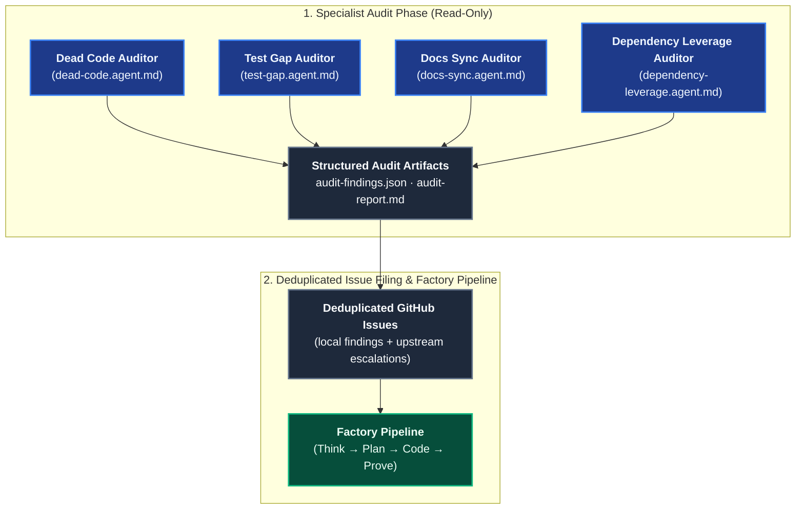

# Codebase Audits

The **Codebase Audits** domain provides read-only specialist audit agents that inspect a repository for dead code, test coverage gaps, documentation drift, and dependency leverage opportunities, emitting deterministic `audit-findings.json` and `audit-report.md` artifacts that feed directly into the issue backlog and factory pipeline.

---

## Domain Architecture



---

## Capabilities Matrix

| Capability | Role | Specialist Agent | Constraints | Output Artifacts |
|---|---|---|---|---|
| **Dead Code Audit** | Unused exports, orphan files, unreachable branches, redundant dependencies | [`dead-code`](./catalog-agents.md#_1-dead-code-auditor-dead-code-agent-md) | Read-only; verify dynamic & public API usage before flagging | `audit-findings.json`, `audit-report.md` |
| **Test Gap Audit** | Untested public APIs, missing edge-case/error-path tests, tautological assertions | [`test-gap`](./catalog-agents.md#_2-test-gap-auditor-test-gap-agent-md) | Read-only; prioritize high-risk public behavior over line coverage | `audit-findings.json`, `audit-report.md` |
| **Docs Sync Audit** | Drift between `README.md` / `docs/` / JSDoc and actual exported code & CLI flags | [`docs-sync`](./catalog-agents.md#_21-docs-sync-auditor-docs-sync-agent-md) | Read-only; every claim verified against actual source files | `audit-findings.json`, `audit-report.md` |
| **Dependency Leverage Audit** | Reimplemented utilities, outdated API usage, upstream ecosystem capability gaps | [`dependency-leverage`](./catalog-agents.md#_22-dependency-leverage-auditor-dependency-leverage-agent-md) | Read-only; distinguishes `local` fixes from `upstream` escalations | `audit-findings.json`, `audit-report.md` |

---

## Specialist Audit Workflows

### 1. Dead Code Audit (`dead-code.agent.md`)
- **Scope**: Unused exported functions/classes/constants, orphan internal modules, dead feature flags, unreachable branches, and unused dependencies in `package.json`.
- **Hard Boundaries**: Read-only (`audit-report.md` and `audit-findings.json` only). Never flags public package exports declared in `package.json` (`main`, `module`, `exports`, `bin`) as dead code.

### 2. Test Gap Audit (`test-gap.agent.md`)
- **Scope**: Public functions, methods, classes, CLI commands, and bug-prone edge cases (boundary values, malformed inputs, state transitions) lacking unit or integration test assertions.
- **Hard Boundaries**: Read-only. Focuses on behavioral risk and public contracts rather than vanity line-coverage percentages.

### 3. Docs Sync Audit (`docs-sync.agent.md`)
- **Scope**: Stale or inaccurate documentation across `README.md`, `docs/`, JSDoc comments, and usage examples compared against current exports, signatures, configuration keys, and scripts.
- **Hard Boundaries**: Read-only. Never flags stylistic wording preferences—only concrete factual inaccuracies or missing public API documentation.

### 4. Dependency Leverage Audit (`dependency-leverage.agent.md`)
- **Scope**: Local code that duplicates helpers already provided by installed dependencies, suboptimal or deprecated dependency calls, and reusable capabilities that should be extracted to an upstream ecosystem library (`scope: "upstream"`).
- **Hard Boundaries**: Read-only. Never proposes adding new third-party dependencies when existing dependencies or standard platform APIs already cover the need.

---

## Structured Audit Output Contract

Every specialist audit agent writes two files in the workspace root:

1. `audit-report.md` — Concise human-readable Markdown summary with an executive summary and a findings table (`#`, `Severity`, `Category`, `Location`, `Title`).
2. `audit-findings.json` — Machine-readable JSON payload consumed by automated audit runners to file deduplicated issues:

```json
{
  "summary": "Brief 1-2 sentence overview of the audit results.",
  "findings": [
    {
      "title": "Short actionable title (under 80 chars)",
      "severity": "high",
      "category": "dead-code",
      "scope": "local",
      "target_repo": "",
      "files": ["src/path/to/file.js"],
      "evidence": "Exact symbol names, line numbers, and why this is a valid finding.",
      "recommendation": "Concrete step-by-step fix instructions.",
      "acceptance_criteria": [
        "Falsifiable criterion 1",
        "All existing tests continue to pass"
      ]
    }
  ]
}
```
