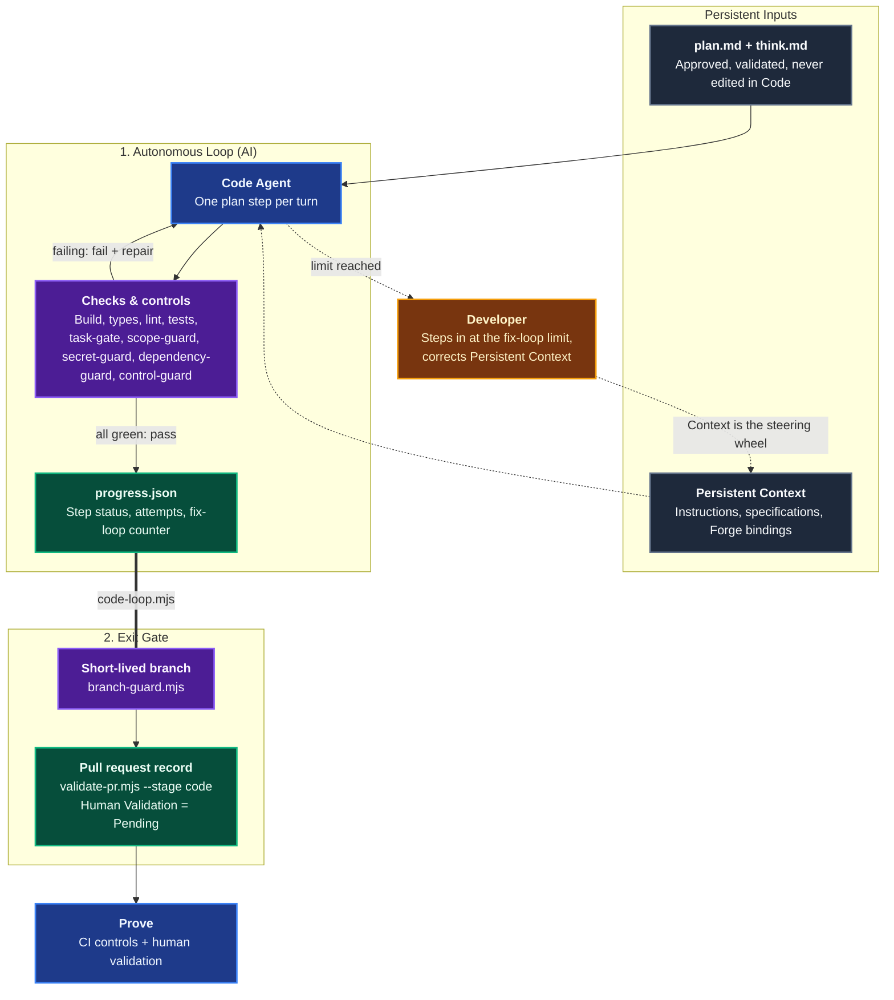
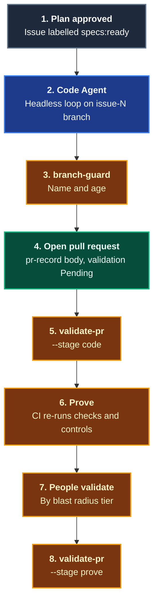

# Code

The **Code** domain turns a validated plan into a pull request through a fast, autonomous loop: generate one plan step, run the checks and controls, fix until green, record the result. It is stage 4 of the [Agentic Software Factory](https://alten-group.github.io/agentic-software-factory/guide/stage-code) and consumes the `think.md` and `plan.md` produced by the [Think & Plan](./domain-think-plan.md) domain.

AI implements. **Developers supervise, they do not write manual code, and step in only at the fix-loop limit.** Coding Pal enforces that mechanically: progress lives in `progress.json` and is written only by a script, the fix-loop limit cannot be reset by the agent, and the pull request record cannot carry a human sign-off until [Prove](./domain-prove.md).

---

## Domain Architecture



---

## Capabilities Matrix

| Capability | Invocation / Entry Point | Specialist Agent | Scoping Instruction | Supporting Skill | Output Artifact |
|---|---|---|---|---|---|
| **Implement a Plan Step by Step** | [`/code`](./catalog-prompts.md) or the [`Code Agent`](./catalog-agents.md) in CI | [`Code Agent`](./catalog-agents.md) | [`code-loop`](./catalog-instructions.md) | [`code-loop`](./catalog-skills.md) | Commits on a short-lived branch, `specs/issue-<n>/progress.json` |
| **Fix-Loop Limit & Branch Rules** | `code-loop.mjs fail`, `branch-guard.mjs` | [`Code Agent`](./catalog-agents.md) | [`code-loop`](./catalog-instructions.md) | [`code-loop`](./catalog-skills.md) | Attempt counters, branch verdict |
| **Pull Request Record** | `validate-pr.mjs --stage code`, template in `.github/` | [`Code Agent`](./catalog-agents.md) | [`code-loop`](./catalog-instructions.md) | [`pr-record`](./catalog-skills.md) | Pull request body with links, criteria traceability, dependencies, blast radius, `Pending` validation |

---

## Capability Workflows

### 1. Implement a Plan Step by Step

- **When to Run**: After the Developer approves `plan.md` by recording `Approved By` in its `## Approval` section (issue labelled `specs:ready`). Interactively in the IDE (`/code 42`, or `/code 42 3` for one step) or headlessly in CI.
- **Why a Loop**: Running the checks costs seconds, not a CI cycle. The agent reads the failure, repairs, and runs again, so humans see only green work. One step per turn keeps each change small enough to verify and to revert.
- **Workflow Steps**:
  1. **Ground**: The `Code Agent` reads `think.md`, `plan.md`, the Forge bindings, and the instructions they reference. It stops if the plan fails `validate-plan.mjs --stage approved`, has an open question, or is not approved by a named Developer (`code-loop` refuses to start).
  2. **Branch**: It creates `feature|fix|chore/issue-<n>-<slug>` from `main` or `develop` and checks it with `branch-guard.mjs`.
  3. **Step**: `code-loop.mjs next` then `start <n>`. It applies the step's `New Code`, adjusted only to fit the repository, and reports any divergence. It writes only the step's `Files`.
  4. **Check**: It runs the step's `Verification` and `Bootable Check`, the project's build, types, lint, and tests, and the controls: `task-gate`, `scope-guard`, `secret-guard`, `dependency-guard`, `control-guard`, and, when installed and relevant, `criteria-verify` on the test reports, `test-probe` on new or updated tests, `preview-smoke` on a running preview, `contract-compat` for a changed API contract, and `mutation-bar` on the changed files.
  5. **Fix or pass**: Failing, it runs `fail <n> --reason "..."`, repairs, and checks again. Green, it runs `pass <n>` and commits.
  6. **Repeat** until every step is `done`.
  ```bash
  node .agents/skills/code-loop/scripts/code-loop.mjs next  --dir specs/issue-42
  node .agents/skills/code-loop/scripts/code-loop.mjs start 1 --dir specs/issue-42
  node .agents/skills/code-loop/scripts/code-loop.mjs pass 1  --dir specs/issue-42
  node .agents/skills/code-loop/scripts/code-loop.mjs fail 2  --dir specs/issue-42 --reason "AC-2 test returns 200, expected 403"
  node .agents/skills/code-loop/scripts/code-loop.mjs check-history --dir specs/issue-42
  ```
- **Context Is the Steering Wheel**: When the agent misunderstands a pattern, it records a context correction suggestion and stops. The Developer fixes the Persistent Context, and the agent runs again. Nobody hand-fixes the code.

#### What the Loop Scripts Enforce

| Check | Why |
|---|---|
| Steps run strictly in plan order, one in progress at a time | Atomic, revertible changes |
| `pass` needs `in_progress`; `fail` needs a reason | Every attempt is recorded and explained |
| Fix-loop limit of 5 per work item, fixed at creation | Bounded autonomy: the Developer steps in at the limit |
| More than 3 attempts prints a warning | A signal that the plan was too big or too vague |
| No `reset-attempts`; `--limit` is set at creation (1 to 5) and cannot change later | The agent cannot buy itself more attempts |
| `fixLoop.attempts` must equal the sum of step attempts | Hand edits that hide failures are rejected |
| `plan.md` sha256 must match `progress.json` once Code started | The approved plan is the one being built |
| `start` and `next` refuse a plan whose `## Approval` -> `Approved By` is not `<name> (Developer) on YYYY-MM-DD` with a person's name; `status` shows the approval line | Code starts only from an approved plan; the agent never approves |
| `check-history --dir specs/issue-<n> [--base origin/main]` compares `progress.json` with the base and every commit that touched it: deleted file, lower attempts, raised limit, or a changed plan hash after Code started fails | Deleting or rewriting `progress.json` cannot reset the fix-loop counter. CI runs it on the controls job |
| Plan steps are parsed fence-aware | `### Step` text inside `New Code` is not a step |
| Branch name `feature`, `fix`, or `chore` + `/issue-<n>-<slug>`, never `main`, `develop`, `release/*` | Agents work on short-lived branches |
| Branch age from its first commit not on the base, at most 5 days | Long-running branches break agentic context |

### 2. Pull Request Record

- **When to Run**: When every plan step is `done`, as the Code exit gate. The same body is validated again in [Prove](./domain-prove.md) once people have validated.
- **Why a Contract**: A free-form description hides what was proven and who decided. Five fixed sections show what the pull request closes, which acceptance criteria are proven by which test, which dependencies it adds, how risky it is, and who validated it.
- **Workflow Steps**:
  1. **Template**: Install `skills/pr-record/references/pull_request_template.md` as `.github/pull_request_template.md`.
  2. **Fill**: The agent writes the links, one traceability row per acceptance criterion with its test, the dependencies declared in the plan, and the tier and rollback from `think.md`. Every Human Validation field stays `Pending`.
  3. **Validate**:
     ```bash
     node .agents/skills/pr-record/scripts/validate-pr.mjs \
       --body pr.md --dir specs/issue-42 --stage code --added-deps "zod"
     ```
  4. **Prove**: After the people validate, CI runs `--stage prove` to check the record for the blast radius tier.

#### What the Validator Enforces

| Check | Stage | Why |
|---|---|---|
| Exact five sections in order; HTML comments ignored | both | Predictable for reviewers and CI |
| `Closes`, `Plan`, `Think` resolve to the work item's files | both | The pull request links to the backlog issue and the Plan |
| Every plan `AC-<n>` traced to a test with status `Passing` | both | Exit gate: all acceptance criteria have automated tests |
| Added dependencies declared, justified, and present in the plan | both | Dependencies are bounded |
| `Tier` equals the effective tier; `Rollback` matches `think.md` for High and Critical | both | Blast radius is set once, in Think |
| All plan steps `done`, attempts within the limit (at most 5), plan unchanged | code | Proof the loop ran and stayed bounded |
| Every Human Validation field is `Pending` | code | AI never carries a human sign-off |
| Low: `Auto-merge` or a Developer; Medium: a Developer | prove | Governance: minimum human validation |
| High: Developer and Architect (different people), and `Rollback Validated` | prove | Dual validation |
| Critical: Architect and Product Owner `Joint Sign-off`, `Staged Rollout`, `Rollback Validated` | prove | Joint sign-off |
| `Rollback Validated` (High, Critical) reads `<mechanism> by <name> (DevOps) on YYYY-MM-DD; <name> (Product Owner) on YYYY-MM-DD`: two different named people, a mechanism that matches `think.md` (the factory has no project manager role, so the Product Owner stands for the business side) | prove | Rollback is validated by operations and by the business, not by the author |
| The plan is approved: `## Approval` -> `Approved By` names a Developer | code | Code starts only from a plan a person approved |
| Confirmations are `Confirmed by <name> (<role>) on YYYY-MM-DD` with an exact role, a person's name, and a date not before the PR record date | prove | Accountability resolves to a named person |
| `line by line` or `line-by-line` in Human Validation | both | Line-by-line review is banned as a gate |

#### Storage & GitHub Pull Request Pattern



1. **Short-lived branches**: `feature|fix|chore/issue-<n>-<slug>`, fetched with full history so `branch-guard` can read the branch age.
2. **Pull request body as record**: `gh pr view --json body -q .body > pr.md` feeds both validation stages.
3. **Fix loop continues in CI**: If Prove fails, the agent repairs and the loop runs again within the same work-item limit.
4. **Human gate**: Only a person fills Human Validation, by the validators the tier requires.

- **Falsifiable Done When**:
  - `code-loop.mjs status` shows every plan step `done` with fix-loop attempts within the limit, and `branch-guard.mjs` exits with code 0.
  - `skills/pr-record/scripts/validate-pr.mjs --stage code` exits with code 0 (including the approved plan) and every Human Validation field is `Pending`.
  - `code-loop.mjs check-history` exits with code 0: no counter in `progress.json` was lowered, in any commit of the branch.
  - Only files in the plan's `In Scope` changed, no control was weakened, and no human sign-off was written by an agent.

---

## Related Catalogs & Schemas

- [Prompts Catalog](./catalog-prompts.md)
- [Agents Catalog](./catalog-agents.md)
- [Instructions Catalog](./catalog-instructions.md)
- [Skills Catalog](./catalog-skills.md)
- [Persistent Context Architecture](./persistent-context.md)
- [Deterministic Controls](./deterministic-controls.md)
- [Think & Plan Domain](./domain-think-plan.md)
- [Prove Domain](./domain-prove.md)
- [Controls Domain](./domain-controls.md)
