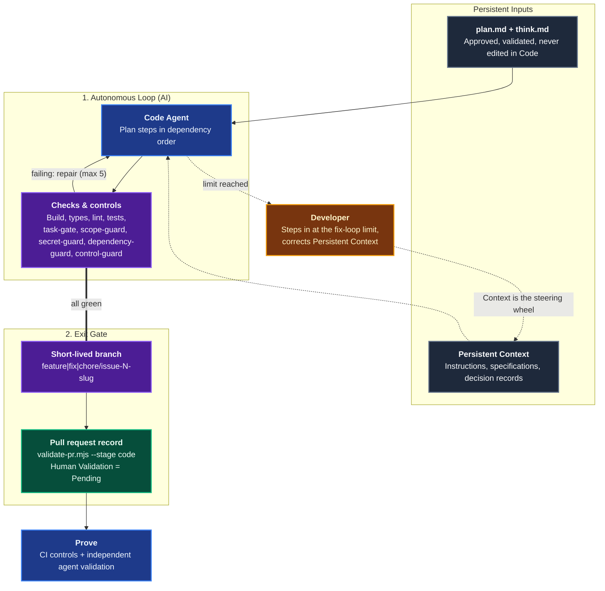
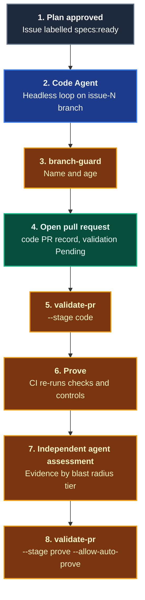

# Code

The **Code** domain turns a validated plan into a pull request through a fast, autonomous loop: implement the plan steps in dependency order, run the checks and controls, fix until green, and record the result in the pull request body. It is stage 4 of the [Agentic Software Factory](https://alten-group.github.io/agentic-software-factory/guide/stage-code) and consumes the `think.md` and `plan.md` produced by the [Think & Plan](./domain-think-plan.md) domain.

AI implements. **Developers supervise, they do not write manual code, and step in only at the fix-loop limit.** Coding Pal enforces that mechanically: the fix-loop limit of 5 attempts bounds autonomous retries, and the pull request record cannot carry a human sign-off until [Prove](./domain-prove.md).

---

## Domain Architecture



---

## Capabilities Matrix

| Capability | Invocation / Entry Point | Specialist Agent | Scoping Instruction | Supporting Skill | Output Artifact |
|---|---|---|---|---|---|
| **Implement a Plan Step by Step** | [`/code`](./catalog-prompts.md) or the [`Code Agent`](./catalog-agents.md) in CI, `branch-guard.mjs` | [`Code Agent`](./catalog-agents.md) | [`code`](./catalog-instructions.md) | [`code`](./catalog-skills.md) | Commits on a short-lived branch |
| **Pull Request Record** | `validate-pr.mjs --stage code`, template in `.github/` | [`Code Agent`](./catalog-agents.md) | [`code`](./catalog-instructions.md) | [`code`](./catalog-skills.md) | Pull request body with links, criteria traceability, dependencies, blast radius, `Pending` validation |

---

## Capability Workflows

### 1. Implement a Plan Step by Step

- **When to Run**: After Plan validation and explicit automated approval (`Automated by <identity> on YYYY-MM-DD`), or an actual human approval when requested. All risk tiers can proceed automatically. Run interactively or headlessly in CI.
- **Why a Loop**: Running the checks costs seconds, not a CI cycle. The agent reads the failure, repairs, and runs again, so humans see only green work. Implementing steps in dependency order keeps each change small enough to verify and to revert.
- **Workflow Steps**:
  1. **Ground**: Read Think, Plan, and constraints. Stop on invalid records or unresolved questions; valid automated approval satisfies the approval gate without a human signature.
  2. **Branch**: Create `feature|fix|chore/issue-<n>-<slug>` from `main` or `develop`.
  3. **Step**: Implement each step's `Action` in dependency order, adjusted only to fit the repository, and report any divergence. Write only the step's `Files`.
  4. **Check**: Run the step's `Verification` and `Bootable Check`, the project's build, types, lint, and tests, and the controls: `task-gate`, `scope-guard`, `secret-guard`, `dependency-guard`, `control-guard`, and, when installed and relevant, `criteria-verify` on the test reports, `test-probe` on new or updated tests, and `preview-smoke` on a running preview.
  5. **Fix or pass**: Failing, repair within the fix-loop limit of 5 attempts and check again. Green, commit the step.
  6. **Repeat** until every step is complete.
- **Context Is the Steering Wheel**: When the agent misunderstands a pattern, it records a context correction suggestion and stops. The Developer fixes the Persistent Context, and the agent runs again. Nobody hand-fixes the code.

### 2. Pull Request Record

- **When to Run**: When every plan step is done, as the Code exit gate. The same body is checked after independent automated [Prove](./domain-prove.md) assessment with `--stage prove --allow-auto-prove`.
- **Why a Contract**: A free-form description hides what was proven and who decided. Five fixed sections show what the pull request closes, which acceptance criteria are proven by which test, which dependencies it adds, how risky it is, and who validated it.
- **Workflow Steps**:
  1. **Template**: Install `skills/code/references/pull_request_template.md` as `.github/pull_request_template.md`.
  2. **Fill**: The agent writes the links, one traceability row per acceptance criterion with its test, the dependencies declared in the plan, and the tier and rollback from `think.md`. Every Human Validation field stays `Pending`.
  3. **Validate**:
     ```bash
     node .agents/skills/code/scripts/validate-pr.mjs \
       --body pr.md --dir specs/issue-42 --stage code --added-deps "zod"
     ```
  4. **Prove**: After independent assessment passes, CI runs `--stage prove --allow-auto-prove`. All tiers permit automation; High/Critical require rollback evidence and Critical requires a staged rollout reference.

#### What the Validator Enforces

| Check | Stage | Why |
|---|---|---|
| Exact five sections in order; HTML comments ignored | both | Predictable for reviewers and CI |
| `Closes`, `Plan`, `Think` resolve to the work item's files | both | The pull request links to the backlog issue and the Plan |
| Every plan `AC-<n>` traced to a test with status `Passing` | both | Exit gate: all acceptance criteria have automated tests |
| Added dependencies declared, justified, and present in the plan | both | Dependencies are bounded |
| `Tier` equals the effective tier; `Rollback` matches `think.md` for High and Critical | both | Blast radius is set once, in Think |
| Every Human Validation field is `Pending` | code | AI never carries a human sign-off |
| Three assessment fields are `Auto-merge` with `--allow-auto-prove`, at every tier | prove | Evidence-backed automated assessment, not human sign-off |
| High/Critical: `Rollback Validated` is `<Think rollback>; Automated verification` | prove | Actual rollback verification evidence must exist in the Prove report |
| Critical: `Joint Sign-off: Automated verification` and a staged rollout reference | prove | Autonomous decisions retain rollout controls |
| `Approved By: Automated by <identity> on YYYY-MM-DD`, or actual human approval | code | Validated records, no mandatory human gate |
| Confirmations are `Confirmed by <name> (<role>) on YYYY-MM-DD` with an exact role, a person's name, and a date not before the PR record date | prove | Accountability resolves to a named person |
| `line by line` or `line-by-line` in Human Validation | both | Line-by-line review is banned as a gate |

#### Storage & GitHub Pull Request Pattern



1. **Short-lived branches**: `feature|fix|chore/issue-<n>-<slug>` branched from `main` or `develop`, checked by `branch-guard.mjs`.
2. **Pull request body as record**: `gh pr view --json body -q .body > pr.md` feeds both validation stages.
3. **Fix loop continues in CI**: If Prove fails, the agent repairs and the loop runs again within the work-item limit.
4. **Automated validation**: After independent Prove passes, record explicitly automated results in the legacy Human Validation section. High/Critical retain rollback and rollout evidence requirements; human review is optional when requested.

- **Falsifiable Done When**:
  - Every plan step's `Verification` and `Bootable Check` pass with fix-loop attempts within the limit of 5.
  - `skills/code/scripts/branch-guard.mjs` and `skills/code/scripts/validate-pr.mjs --stage code` exit with code 0 (including the approved plan) and every Human Validation field is `Pending`.
  - Only files in the plan's `In Scope` changed, no control was weakened, and no human sign-off was written by an agent.

---

## Related Catalogs & Schemas

- [Prompts Catalog](./catalog-prompts.md)
- [Agents Catalog](./catalog-agents.md)
- [Instructions Catalog](./catalog-instructions.md)
- [Skills Catalog](./catalog-skills.md)
- [Persistent Context Architecture](./persistent-context.md)
- [Deterministic Controls](./deterministic-controls.md)
- [Think & Plan Domain](./domain-think-plan.md)
- [Prove Domain](./domain-prove.md)
- [Controls Domain](./domain-controls.md)
