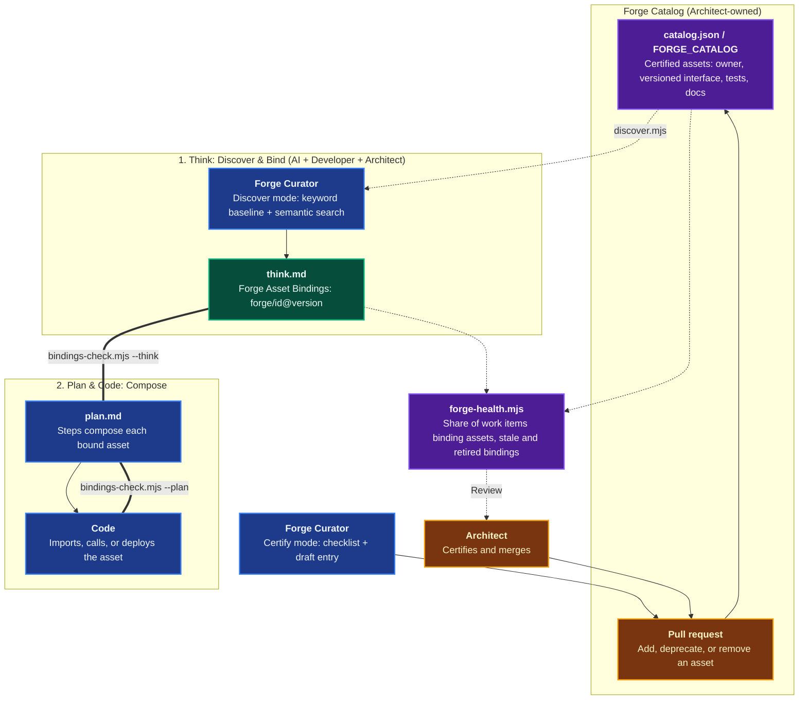

# Forge

The **Forge** domain makes the organization's catalog of certified, reusable building blocks usable by AI agents: shared services, reusable code, in-context templates, and interface contracts. It serves three stages of the [Agentic Software Factory](https://alten-group.github.io/agentic-software-factory/guide/forge): [Think](./domain-think-plan.md) searches it and records **Forge asset bindings**, Plan reads the bindings so its steps compose them, and Code imports or calls the bound assets instead of generating the same logic again.

AI discovers, binds, and drafts catalog entries. **The Architect owns the Forge and certifies assets.** Coding Pal enforces the rules mechanically: a binding must name a real asset at a real version, a retired asset cannot be bound, and a custom build must say what was searched.

---

## The Seed Catalog

Coding Pal ships `catalog.json` inside the `forge` skill with the first two assets of the ALTEN Forge. Both are open source (MIT), maintained by ALTEN, and published as Docker images on `ghcr.io/alten-group`.

| Asset | What it is | Use it for | Version |
|---|---|---|---|
| [**Gatelin**](https://github.com/ALTEN-group/Gatelin) ([docs](https://gatelin.fr)) | Backend for Frontend (BFF) behind an edge reverse proxy (Traefik, nginx, Envoy). Images `gatelin` (BFF with Admin UI) and `gatelin-migration` | JWT sessions (access and refresh tokens), role-based access control per route, property, and condition, dynamic proxy and authenticated forwarding to internal microservices, route/role/permission management, CORS management, Angular Admin UI under `/admin` | `0.1.0-alpha.9` (2026-09-07), alpha |
| [**Foxnox**](https://github.com/ALTEN-group/Foxnox) ([docs](https://alten-group.github.io/Foxnox)) | Internal password and account-security service. Images `foxnox` (API with workflow pages and Admin UI) and `foxnox-migration` | Credentials kept out of other services (hashes, rotation, expiry, lockout), TOTP 2FA enrollment and verification, short-lived typed tokens (reset, unlock, recovery, login challenges), trusted devices, security questions, password policies, server-rendered account pages (EN/FR, white-label ready), Angular Admin UI | `0.1.0-alpha.3` (2026-10-10), alpha |

They compose: Foxnox is an internal password store, so put a BFF in front of it as the public API layer. Gatelin is one such BFF, not a requirement. Each asset has an integration guide (Gatelin: [integration](https://gatelin.fr/guide/integration), [frontend](https://gatelin.fr/guide/frontend); Foxnox: [integration](https://alten-group.github.io/Foxnox/guide/integration), [frontend](https://alten-group.github.io/Foxnox/guide/frontend)). Both are alpha releases: a Think record that binds them acknowledges that maturity.

An organization replaces or extends the seed by pointing `FORGE_CATALOG` (or `--catalog`) at its own catalog file.

---

## Domain Architecture



---

## Capabilities Matrix

| Capability | Invocation / Entry Point | Specialist Agent | Scoping Instruction | Supporting Skill | Output Artifact |
|---|---|---|---|---|---|
| **Discover Reusable Assets** | [`/forge-search`](./catalog-prompts.md) | [`Forge Curator`](./catalog-agents.md) (discover mode) | none (the contract of the skill) | [`forge`](./catalog-skills.md) | Candidate assets with fit, gaps, and bindings text for `think.md` |
| **Certify a Proposed Asset** | [`/forge-certify`](./catalog-prompts.md) | [`Forge Curator`](./catalog-agents.md) (certify mode) | [`forge`](./catalog-instructions.md) (catalog entries) | [`forge`](./catalog-skills.md) | Checklist with evidence and a draft catalog entry for a pull request |
| **Check Bindings** | `bindings-check.mjs` in CI or by the Thinker / Planner | [`Thinker`](./catalog-agents.md), [`Planner`](./catalog-agents.md) | [`think`](./catalog-instructions.md), [`plan`](./catalog-instructions.md) | [`forge`](./catalog-skills.md) | Pass or fail with warnings for `think.md` and `plan.md` |
| **Forge Health Report** | `forge-health.mjs` (scheduled or on demand) | none (deterministic) | none | [`forge`](./catalog-skills.md) | Markdown report of health signals |

---

## Capability Workflows

### 1. Discover and Bind (Think)

- **When to Run**: At the start of [Think](./domain-think-plan.md), before choosing between `Forge reuse`, `Hybrid`, and `Custom build`. Interactively with `/forge-search "<the need>"`.
- **Why a Catalog**: Left unguided, an agent regenerates authentication, session handling, and similar logic for every work item. That introduces drift and unverified security code. A catalog of certified assets turns the same need into a call.
- **Workflow Steps**:
  1. **Search**: The `Forge Curator` runs the deterministic baseline and then searches semantically:
     ```bash
     node .agents/skills/forge/scripts/discover.mjs --need "users sign in with JWT sessions and role based access" --json
     ```
     The ranking is a field-weighted BM25 over name, keywords, capabilities, and summary. The same need and catalog always give the same order. It excludes `removed` assets and flags `deprecated` ones with their replacement.
  2. **Judge**: It reads each plausible asset's capabilities, gaps, and `composesWith` and reports options for Think, including alpha or beta maturity.
  3. **Bind**: The chosen assets are recorded in `think.md`, with the version the catalog lists:
     ```markdown
     ## Forge Asset Bindings
     - **forge/gatelin@0.1.0-alpha.9:** Fronts the API for JWT sessions and RBAC
     - **forge/foxnox@0.1.0-alpha.3:** Stores credentials and TOTP behind Gatelin
     ```
     A custom build states `- **None:** <reason>` and a `Custom Build Reason` that names what was searched.
  4. **Check**:
     ```bash
     node .agents/skills/forge/scripts/bindings-check.mjs --think specs/issue-42/think.md
     ```
  5. **Decide**: The Developer and the Architect accept or change the bindings. AI proposes them.

#### What `bindings-check.mjs` Enforces

| Check | Why |
|---|---|
| Each binding is `forge/<id>@<version>` with a composition note | Plan and Code read the bindings mechanically |
| The asset exists in the catalog | No invented assets |
| Deprecated asset: error naming the replacement. Removed asset: error | Agents never bind to something that is going away |
| Version equals the catalog version. Older: warning (stale). Newer: error | Bindings track what is certified |
| Alpha or beta maturity: warning until the `Reasoning` acknowledges it | The risk is a recorded decision |
| `Forge reuse` or `Hybrid` needs real bindings. `None` needs a reason and excludes real bindings | The binding matches the chosen approach |
| `Custom build` needs a `Custom Build Reason`, and the Forge matches for the Problem Statement and Approach are printed | The reason can be challenged against what the Forge offers |
| `--plan`: every bound asset appears in an `Action` or `New Code` | The Plan composes the bindings. A missing mention is a warning |

### 2. Compose in Plan and Code

- **When to Run**: After Think is validated.
- **Plan**: Each bound asset appears in at least one step. The step names the asset, its integration guide, and how the application calls it:
  ```bash
  node .agents/skills/forge/scripts/bindings-check.mjs --think specs/issue-42/think.md --plan specs/issue-42/plan.md
  ```
- **Code**: The agent deploys the bound image, calls the bound API, imports the bound package, or copies the bound template. It does not re-implement what the asset offers. A gap in an asset is raised with the owner, not patched locally.

### 3. Add an Asset to the Forge

- **When to Run**: A team proposes a service, library, template, or contract. Interactively with `/forge-certify <repository URL or path>`.
- **Workflow Steps**:
  1. **Evaluate**: The `Forge Curator` reads the repository and rates the certification checklist (owner, versioned interface, tests, documentation, consumable artifact, license) as `met`, `not met`, or `unknown`, with evidence.
  2. **Draft**: It writes the catalog entry from verified facts only. Unknown facts stay unknown.
  3. **Validate**:
     ```bash
     node .agents/skills/forge/scripts/validate-forge.mjs --catalog forge-catalog.json
     ```
  4. **Certify**: The entry goes to the Architect as a pull request. Merging it is the certification. The agent never edits the catalog and never writes "certified".
- **Deprecation**: Set `status: deprecated`, a `replacement` (an active asset), and a `removalDate` after today. When the date passes the asset is `removed` and unbindable.

#### What `validate-forge.mjs` Enforces

| Check | Why |
|---|---|
| Unique ids, known `kind`, `maturity`, and `status`, no unknown fields | A catalog that cannot drift silently |
| Semantic `version` (prerelease allowed) and an ISO `releasedAt` that is not in the future. `stable` needs 1.0.0 or above | Versioned, dated releases |
| An `active` or `deprecated` asset has an owner, interface (`type`, `docs`, `contract`), artifacts, tests, documentation, license, and repository | Certified before listed |
| All URLs are https | No plain-text endpoints in documentation |
| `composesWith` ids exist | A consistent composition graph |
| `deprecated` needs an existing, active `replacement` and a future `removalDate`. A passed date requires `removed` | Explicit deprecation |

### 4. Forge Health

- **When to Run**: Periodically, before the Architect's Forge review.
- **Workflow**:
  ```bash
  node .agents/skills/forge/scripts/forge-health.mjs --catalog forge-catalog.json --specs specs --stale-days 180
  ```
  The report covers the share of work items (`specs/issue-*/think.md`) that bind at least one asset, assets without an owner, assets whose latest release is older than `--stale-days`, bindings pinned to non-current versions, bindings to deprecated or removed assets, bindings to assets missing from the catalog, and custom builds with an empty reason. `--strict` exits 1 when any warning signal is raised.
- **Boundary**: The report measures and decides nothing. Duplicate logic that a Forge asset covers is not measured: run `discover.mjs` on custom builds and review the matches.

- **Falsifiable Done When**:
  - `validate-forge.mjs` accepts the catalog with exit code 0.
  - `bindings-check.mjs` accepts the Think record (and the Plan with `--plan`) with exit code 0, and every warning is answered in the Think record.
  - No asset, version, or URL in a binding or catalog entry was invented.
  - No catalog change was merged without the Architect.

---

## Related Catalogs & Schemas

- [Prompts Catalog](./catalog-prompts.md)
- [Agents Catalog](./catalog-agents.md)
- [Instructions Catalog](./catalog-instructions.md)
- [Skills Catalog](./catalog-skills.md)
- [Persistent Context Architecture](./persistent-context.md)
- [Think & Plan Domain](./domain-think-plan.md)
- [Triage Domain](./domain-triage.md)
- [Specs & Docs Domain](./domain-docs.md)
