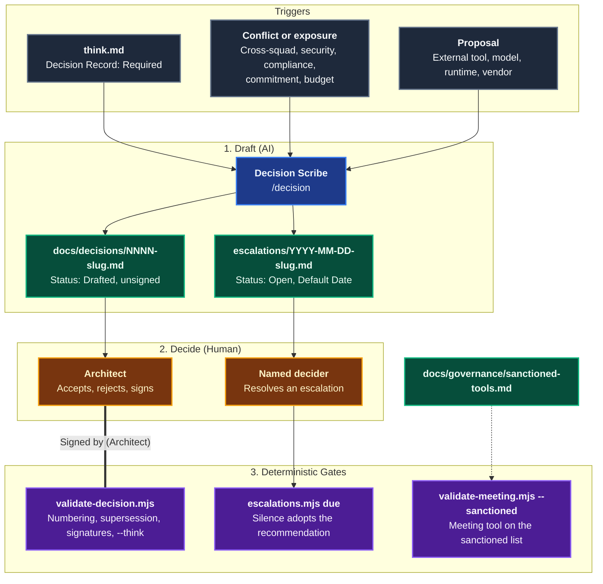

# Governance & Decisions

The **Governance** domain makes decision rights explicit and mechanical. The [Agentic Software Factory](https://alten-group.github.io/agentic-software-factory/guide/governance) says the squad decides unless a decision is on a short list reserved for a named role. Coding Pal gives each reserved decision a record type and a validator, so that a record cannot claim a decision a person did not make.

AI drafts. **The Architect decides and signs.** An AI-produced decision record is always `Drafted: unsigned`, and any other status is only valid with the signature of a named person with the Architect role.

---

## Domain Architecture



---

## Capabilities Matrix

| Capability | Invocation / Entry Point | Specialist Agent | Scoping Instruction | Supporting Skill | Output Artifact |
|---|---|---|---|---|---|
| **Decision Record** | [`/decision`](./catalog-prompts.md) | [`Decision Scribe`](./catalog-agents.md) | [`decision-record`](./catalog-instructions.md) | [`decision-record`](./catalog-skills.md) | `docs/decisions/<NNNN>-<slug>.md` (always `Drafted` from AI) |
| **Escalation** | [`/decision`](./catalog-prompts.md) and `escalations.mjs due` in CI | [`Decision Scribe`](./catalog-agents.md) | [`decision-record`](./catalog-instructions.md) | [`decision-record`](./catalog-skills.md) | `docs/decisions/escalations/<YYYY-MM-DD>-<slug>.md` |
| **Sanctioned Tools** | `validate-meeting.mjs --sanctioned` in CI | none (policy file owned by the Architect) | [`meeting-pack`](./catalog-instructions.md) | [`meeting-pack`](./catalog-skills.md) | `docs/governance/sanctioned-tools.md` |
| **Flow Metrics** | `flow-metrics.mjs` in CI or the retrospective | none | none | [`flow-metrics`](./catalog-skills.md) | `metrics/events.jsonl` and its report: see [Flow Metrics](./domain-metrics.md) |

---

## Who Decides

**The squad decides**, unless the decision is in this table. Each row maps to the Coding Pal primitive that records it and the validator that checks the record.

| Decision | Decided by | Consulted | Recorded as | Coding Pal primitive | Validator |
|---|---|---|---|---|---|
| What to build next inside the agreed outcome | Product Owner | Squad, customers | Scorecard row | [`triage`](./domain-triage.md) `triage.md` | `validate-triage.mjs --stage final` |
| Whether to run an experiment | Product Owner | Architect | Hypothesis entry | `hypothesis-ledger` | `ledger.mjs validate` |
| Implementation approach inside the squad's code | Developer | Architect | Pull request | [`think-plan`](./domain-think-plan.md) approach, `pr-record` | `validate-specs.mjs`, `validate-pr.mjs` |
| Public contract or cross-service boundary change | Architect | Owning squads | Decision record | `decision-record`, Type `contract-change` | `validate-decision.mjs` |
| Data model change affecting other squads | Architect | Affected squads | Decision record + migration plan | `decision-record`, Type `data-model` (`Migration Plan`) | `validate-decision.mjs` |
| Security-sensitive change (auth, PII, billing) | Architect | Developer, squad | Review record on the pull request | `pr-record` dual validation, `security-gate`; `decision-record` Type `security` when it sets lasting policy | `validate-pr.mjs`, `validate-decision.mjs` |
| Adding a new runtime, database, or vendor | Architect | DevOps | Decision record | `decision-record`, Type `runtime-vendor` | `validate-decision.mjs` |
| AI usage policy and model access | Architect | Legal | Policy version | `decision-record`, Type `ai-policy` (the accepted record number is the policy version) | `validate-decision.mjs` |
| Adopting a new model, agent, or prompt standard | Architect | Squads | Evaluation report | `decision-record`, Type `model-adoption` (`Evaluation Report` must exist) | `validate-decision.mjs --root .` |
| Release of a customer-facing commitment | Product Owner | Architect | Changelog | `release-plan` (`Customer Commitment`, `Changelog`) | `validate-release.mjs` |
| Rollback during an incident | DevOps or QA and maintainer | None: act first | Incident record | `release-plan` (`Decided By`), `incident-record` | `validate-release.mjs` |
| Deleting an invalidated feature | Product Owner | Squad | Ledger verdict | `hypothesis-ledger` (`Decided`, `Delete feature`) | `ledger.mjs validate`, `ledger.mjs due` |

---

## Capability Workflows

### 1. Decision Record

- **When to Run**: When `think.md` has `## Decision Record` with `Required: yes` (the approach alters a public API, changes a schema, or shifts service boundaries; a `Critical` blast radius always requires one), or when a decision in the table above is made outside a Think record. Interactively in the IDE (`/decision specs/issue-42/think.md`) or headlessly in CI.
- **Why a Contract**: A narrative ADR hides whether alternatives were weighed and whether anyone with authority agreed. A fixed structure shows the options, the cons, and the signature at a glance, and a validator rejects what a model cannot be trusted to self-police.
- **Workflow Steps**:
  1. **Draft**: `Decision Scribe` reads the Think record, picks the `Type`, takes the next free number, and writes `docs/decisions/<NNNN>-<slug>.md` with `Status: Drafted` and `Signature: Drafted: unsigned`.
  2. **Validate**:
     ```bash
     node .agents/skills/decision-record/scripts/validate-decision.mjs \
       --file docs/decisions/0007-rbac-via-forge.md --think specs/issue-42/think.md
     ```
  3. **Decide**: The Architect reviews, sets `Status` to `Accepted` or `Rejected`, and writes `Signed by <name> (Architect) on <date>`. `think.md` is updated from `Drafted` to `Signed`.
  4. **Gate**: CI validates the whole directory on every pull request that touches `docs/decisions/`:
     ```bash
     node .agents/skills/decision-record/scripts/validate-decision.mjs --dir docs/decisions
     ```
  5. **Reverse**: A reversed decision is a new record with `Supersedes: <NNNN>`. The old record becomes `Superseded`; it is never edited or deleted.

#### What the Validator Enforces

| Check | Why |
|---|---|
| `docs/decisions/<NNNN>-<slug>.md`, 4-digit numbers unique and gap-free | A stable history that can be cited by number |
| Exact header fields, `Type` from the table, exact sections `Context`, `Options`, `Decision`, `Consequences` | Predictable for the Architect and downstream agents |
| 2 or more `### Option <N>` blocks, each with real `Pros` and `Cons` | A decision with one option was not a decision |
| `Deciders` are `<name> (<role>)` with a known role and an Architect; a bare role, placeholder, or AI-looking name is rejected | Accountability always resolves to a named person |
| `Drafted` requires `Drafted: unsigned`; any other status requires `Signed by <name> (Architect) on <date>` from a listed Architect, not before the record date | AI proposes, the Architect decides |
| `tooling`: `Native Alternatives Considered` and `Context Preservation` | The factory's proof that a tool outside the core platform cannot be met natively and keeps AI context |
| `data-model`: `Migration Plan`. `model-adoption`: an `Evaluation Report` path that exists | The record names the evidence the governance table requires |
| `Supersedes` targets exist, are older, are superseded once, and carry the matching status | One consistent history |
| `--think`: `Required`, a `Record` path that exists and validates, no `Critical` tier without a record, think `Signed` only for a human-signed record | Think cannot claim a signature the Architect did not give |

### 2. Escalation

Escalate only for: **cross-squad conflict, security exposure, compliance obligation, external commitment, or budget impact**. An escalation names the decision, the options, the recommendation, and the date by which silence means the recommendation is adopted.

- **Record**: `docs/decisions/escalations/<YYYY-MM-DD>-<slug>.md` with `Decision`, `Options` (2 or more), `Recommendation`, `Default Date`, `Reason` (one of the five), and `Status` (`Open`, `Decided`, `Adopted by default`). A `Decided` or defaulted escalation carries a `Resolution` naming the person, or the date it was adopted by default.
- **Weekly check**:
  ```bash
  node .agents/skills/decision-record/scripts/escalations.mjs due --dir docs/decisions/escalations
  ```
  It lists Open escalations due within 2 days and exits 1 for any whose Default Date has passed: silence adopted the recommendation, and the record must say so.

### 3. Sanctioned Tools

Only tools on the sanctioned list may be used with company or client data. The list is `docs/governance/sanctioned-tools.md`, a Markdown bullet list owned by the Architect. Prose, headings, and `#` comments around the bullets are ignored.

```markdown
# Sanctioned Tools

Tools approved for company and client data. A tool is added through a decision record of Type `tooling`.

- Sanctioned meeting tool  # enterprise tenant, DPA signed
- Another approved tool
```

The factory sanctions a tool only when it has **enterprise tenancy**, **no training on submitted data**, **audit logging**, **SSO**, and a **signed data processing agreement**. The decision record that adds the tool states how each requirement is met.

The first enforcement point is the meeting transcript. CI proves that the tool named in the transcript header is on the list:

```bash
node .agents/skills/meeting-pack/scripts/validate-meeting.mjs \
  --dir meetings/2026-09-24-acme-discovery --sanctioned docs/governance/sanctioned-tools.md
```

A tool that is not listed fails with `meeting tool is not on the sanctioned list`.

### 4. Policy Kept in the Factory

Blast radius and required human validation, auditability and retention, cost, and violations are policy, not Coding Pal primitives. They are defined in the [Agentic Software Factory governance guide](https://alten-group.github.io/agentic-software-factory/guide/governance). Coding Pal only adds the mechanical parts: the blast radius tier is set in [Think & Plan](./domain-think-plan.md) and checked in [Code](./domain-code.md), `ai.cost` events feed [Flow Metrics](./domain-metrics.md), and a violation is recorded with `incident-record`, whose postmortem action is a new guard, not a reminder ([Deterministic Controls](./deterministic-controls.md)).

### 5. Anti-Patterns and the Control That Guards Them

Where a mechanical guard exists it is named. **Policy** means no script can enforce it; the factory relies on accountability and the monthly retrospective.

| Factory anti-pattern | Guard in Coding Pal |
|---|---|
| Developers still writing code syntax | `flow-metrics` Human rework rate (`pr.human_edit`, target 0%) detects it; `pr-record` keeps the Human Validation to intent, experience, and safety. Otherwise policy |
| Manual line-by-line syntax reviews | `pr-record` (a Human Validation that claims a line-by-line review is rejected); `flow-metrics` validation turnaround shows reviewers slipping into reading (trend only, it never warns) |
| Skipping client meetings and building from stale tickets | `meeting-pack` (confirmed packs only) and `triage` (verbatim, source-checked evidence) |
| The AI center of excellence that owns delivery | Policy |
| Enablement as an approval board | Policy. The mechanical alternative is a guardrail such as `security-gate` or `control-guard` instead of a meeting |
| Technology-layer squads | Policy |
| Skipping Plan | `think-plan` (a validated `plan.md` with testable acceptance criteria that every step serves), `code-loop` (Code runs step by step from `plan.md`; a plan edited after Code started stops the loop) |
| Weak deterministic controls ("Trust the model") | `control-guard` (weakened or skipped tests, lowered thresholds, suppressions), `security-gate`; the full set is in [Prove](./domain-prove.md) |
| Hand-fixing generated bugs | `control-guard` (the bug rule: the new check is committed before the fix), `flow-metrics` Human rework rate (`pr.human_edit`), `context-health` (corrections become Persistent Context) |
| Uniform review effort | `think-plan` (one blast radius tier), `pr-record` (tier must match; High needs dual validation) |
| Batching releases | `release-plan` (exactly one issue per release) |
| Prompting instead of context | `context-health` (a topic corrected or re-explained twice needs an artifact) |
| The everything instruction | `context-health` (instruction length limit, broad `applyTo`, near-duplicates) |
| Stale context left in place | `context-health` (stale files, references to names that no longer exist) |
| Vibes-based rollout | Partial: `decision-record` Type `model-adoption` needs an Architect-signed record that links an evaluation report, and the validator checks that the file exists, not that the evaluation is rigorous. The rigor of the evaluation is policy |
| Agents with production credentials | `control-guard` R7 (an added production secret or `environment: production` in an agent or remediation workflow). `release-plan` states that no AI holds production credentials, but no script checks it beyond R7 |
| Tool sprawl and context fragmentation | `decision-record` Type `tooling` (native alternatives, context preservation). `meeting-pack --sanctioned` covers only the meeting tool, against the sanctioned list. Other tools are policy |
| Counting output volume | `flow-metrics` has no event for lines of code, pull request counts, or suggestion acceptance |
| Never deleting anything | `hypothesis-ledger` (invalidated features not deleted in the cycle are listed), `flow-metrics` feature deletion rate |

- **Falsifiable Done When**:
  - `validate-decision.mjs --dir docs/decisions` exits 0: numbering has no gaps, every non-`Drafted` record carries an Architect signature, and every `Superseded` record is named by its successor.
  - Every AI-authored record is `Drafted` with `Drafted: unsigned`, and no AI name appears under `Deciders` or `Signature`.
  - `escalations.mjs due` reports no overdue Open escalation.
  - `validate-meeting.mjs --sanctioned` accepts every transcript.

---

## Related Catalogs & Schemas

- [Prompts Catalog](./catalog-prompts.md)
- [Agents Catalog](./catalog-agents.md)
- [Instructions Catalog](./catalog-instructions.md)
- [Skills Catalog](./catalog-skills.md)
- [Persistent Context Architecture](./persistent-context.md)
- [Deterministic Controls](./deterministic-controls.md)
- [Think & Plan Domain](./domain-think-plan.md)
- [Meet Domain](./domain-meet.md)
- [Code Domain](./domain-code.md)
- [Prove Domain](./domain-prove.md)
- [Release Domain](./domain-release.md)
- [Learn Domain](./domain-learn.md)
- [Flow Metrics Domain](./domain-metrics.md)
