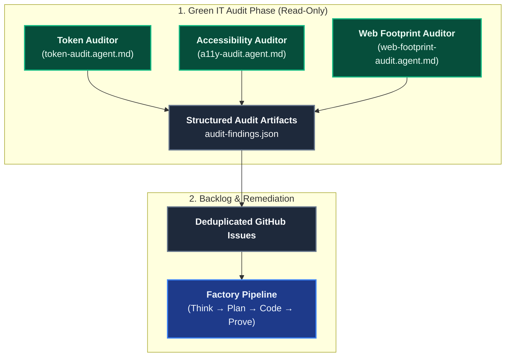

# Green IT

The **Green IT** domain provides read-only audit agents that measure how sober and accessible a project is: token waste in the AI harness, WCAG 2.2 AA accessibility defects, and the weight of the built web output. They work on any project, and each finding is backed by a measurement, a file and line, or a rule id.

**`token-audit` is built to audit the harness itself**: the instructions, skills, agents, and prompts that every project installs. It runs weekly on coding-pal, the source of that harness, so one fix reaches every project that installs it. It can also audit any other project's own assistant files on demand.

---

## Domain Architecture

---

## Capabilities Matrix

| Capability | Specialist Agent | What it measures | Hard boundaries |
|---|---|---|---|
| **Token waste (the harness)** | [`token-audit`](./catalog-agents.md) | Size and scope of harness files (instructions, skills, agents, prompts) and assistant context files (`AGENTS.md`, `CLAUDE.md`, Copilot and Cursor rules, skills), duplicated guidance, loops without a retry cap, LLM steps a deterministic tool could do | Reports only measured savings; token counts are estimates (bytes / 4) |
| **Accessibility** | [`a11y-audit`](./catalog-agents.md) | WCAG 2.2 AA: language, headings, landmarks, names and labels, keyboard and focus, contrast, reduced motion, target size | Cites file, line, and rule; screen-reader checks are `manual-check-needed`, never reported as passed |
| **Web footprint** | [`web-footprint-audit`](./catalog-agents.md) | Built output: bytes per page, requests, third-party origins, fonts, images, JS and CSS weight, caching, eco-design (RGESN, GR491) | Measures the build, not the source; proposes budgets when none are declared |

---

## Principles

1. **Measure, never assume.** A finding without a measurement, file and line, or rule id is not reported.
2. **Project limits first.** Size, scope, and budget thresholds in the audits are defaults. A limit the project declares in its docs, lint config, or contribution guide replaces them.
3. **Tokens are a proxy.** Token and byte counts are reported as such. The audits do not convert them into carbon or kWh figures.
4. **Say what automation cannot check.** Manual checks are listed separately and never counted as passed.
5. **Read-only.** The agents never modify source, tests, or documentation. Remediation goes through the backlog.

---

## Output Contract

Each agent writes `audit-findings.json` at the repository root, in the same format as the [Codebase Audits](./domain-audit.md) agents: one consolidated finding per cause, with `title`, `priority`, `model`, `effort`, `problem`, `affectedFiles`, `suggestedFix`, `acceptanceCriteria`, and `body`. Acceptance criteria are re-measurable with the same command or rule, so a fix can be proved by running the audit again.

---

## Related

- [Codebase Audits](./domain-audit.md): dead code, test gaps, documentation drift, dependency leverage.
- [Automated Tests](./domain-testing.md): k6 performance tests and Playwright end-to-end tests that complement these audits.
- [Agents Catalog](./catalog-agents.md)
