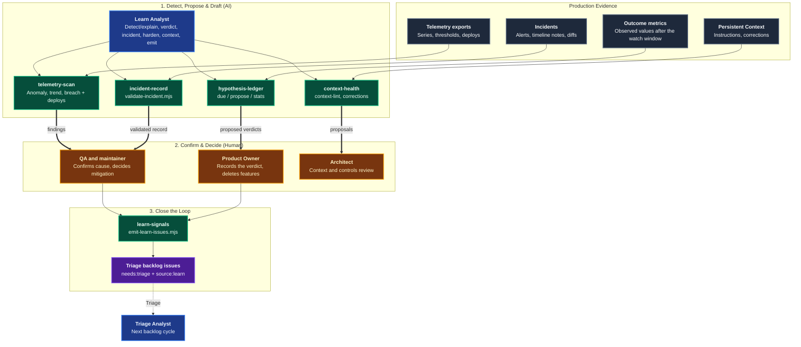
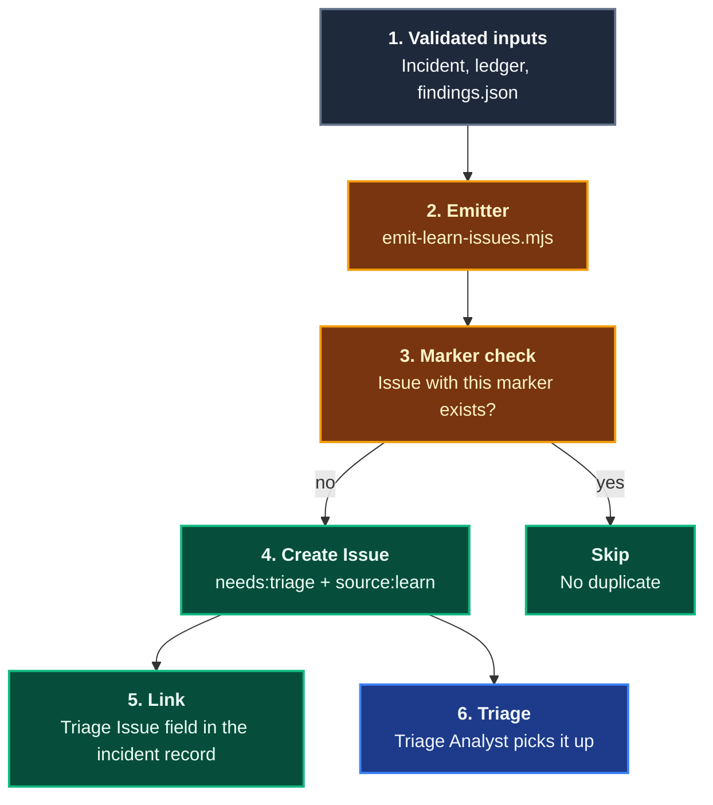

# Learn

The **Learn** domain closes the loop of the [Agentic Software Factory](https://alten-group.github.io/agentic-software-factory/guide/stage-learn). It watches what a release does in production, turns incidents, verdicts, and early warnings into validated records, and opens backlog issues in [Triage](./domain-triage.md) for what it finds. It also keeps [Persistent Context](./persistent-context.md) healthy and feeds the weekly and monthly reviews.

AI proposes and drafts. **Humans decide.** The QA and maintainer confirms causes and decides mitigation. The Product Owner decides every hypothesis verdict. Coding Pal enforces that split mechanically: the ledger tool never writes a verdict, and an incident record or a verdict without a named person and role is invalid.

---

## Domain Architecture



---

## Capabilities Matrix

| Capability | Invocation / Entry Point | Specialist Agent | Scoping Instruction | Supporting Skill | Output Artifact |
|---|---|---|---|---|---|
| **Predictive Monitoring** (Detect / Explain) | The [`Learn Analyst`](./catalog-agents.md) in detect/explain mode, or `telemetry-scan.mjs` in CI | [`Learn Analyst`](./catalog-agents.md) | [`learn`](./catalog-instructions.md) | [`telemetry-scan`](./catalog-skills.md) | Findings (text or JSON) with evidence and the deploys before the onset |
| **Outcome Review** | [`/outcome-review`](./catalog-prompts.md) | [`Learn Analyst`](./catalog-agents.md) (verdict mode) | [`learn`](./catalog-instructions.md) | [`hypothesis-ledger`](./catalog-skills.md) | Due hypotheses with proposed verdicts and maths, validation and deletion rates (no files written) |
| **Hypothesis Ledger** | `ledger.mjs add` and `validate` | [`Learn Analyst`](./catalog-agents.md) | [`learn`](./catalog-instructions.md) | [`hypothesis-ledger`](./catalog-skills.md) | `specs/learn/hypotheses.md` |
| **Incident Record** | [`/incident`](./catalog-prompts.md) | [`Learn Analyst`](./catalog-agents.md) (incident and harden modes) | [`learn`](./catalog-instructions.md) | [`incident-record`](./catalog-skills.md) | `docs/incidents/<date>-<slug>.md` |
| **Persistent Context & Controls Review** | [`/context-review`](./catalog-prompts.md) | [`Learn Analyst`](./catalog-agents.md) (context mode) | [`learn`](./catalog-instructions.md) | [`context-health`](./catalog-skills.md) | Lint report, proposed artifacts, control findings (no files written) |
| **Close the Loop** | `emit-learn-issues.mjs` | [`Learn Analyst`](./catalog-agents.md) (emit mode) | [`learn`](./catalog-instructions.md) | [`learn-signals`](./catalog-skills.md) | `signal-*.md` issue bodies and `signals.json` |
| **Meeting Pre-Reads & Retrospective** | [`/pre-read`](./catalog-prompts.md), [`/operating-retro`](./catalog-prompts.md) | [`Learn Analyst`](./catalog-agents.md) (review-pack mode) | [`learn`](./catalog-instructions.md) | [`hypothesis-ledger`](./catalog-skills.md), [`context-health`](./catalog-skills.md) | Pre-read or retrospective pack (no files written) |

---

## Capability Workflows

### 1. Predictive Monitoring (Detect / Explain)

- **When to Run**: Continuously on exported telemetry, after a release, and whenever a signal looks odd.
- **Why Deterministic**: The scan reads exported files, so the same series gives the same findings. It holds no production credentials and queries nothing.
- **Workflow Steps**:
  1. **Detect**: The scan compares the series with a baseline (supplied, or the first 60% of the series) and with thresholds.
     ```bash
     node .agents/skills/telemetry-scan/scripts/telemetry-scan.mjs \
       --series series.json --thresholds thresholds.json --deploys deploys.json --json > findings.json
     ```
  2. **Explain**: Each finding lists the deploys within 60 minutes before its onset. The `Learn Analyst` correlates them with logs and diffs and proposes a cause.
  3. **Act (human)**: The QA and maintainer confirms the cause and decides whether to mitigate. The rollback thresholds in [Release](./domain-release.md) still trigger automatic rollback on their own.

#### What the Scan Reports

| Finding | Rule | Severity |
|---|---|---|
| `anomaly` | The last 3 points all have \|z\| >= 3 against the baseline | `high` at \|z\| >= 5, otherwise `medium` |
| `breach` | The current value is beyond a threshold | `high` |
| `trend` | The least-squares slope over the last 10 points heads toward a threshold and the ETA is within the horizon (default 120 minutes) | `high` within half the horizon, otherwise `medium` |

Exit codes: `0` scanned, `1` invalid input, `3` at least one `high` finding so CI can alert. Monitoring informs, humans act: the exit code never blocks unrelated work.

### 2. Outcome Review and the Hypothesis Ledger

- **When to Run**: Before the weekly Outcome review, and when a work item that named an outcome metric ships.
- **Workflow Steps**:
  1. **Register**: When the work item ships, add an `Open` row.
     ```bash
     node .agents/skills/hypothesis-ledger/scripts/ledger.mjs add --file specs/learn/hypotheses.md --issue 42 \
       --hypothesis "Order templates shorten order entry" --metric "Minutes per order" \
       --baseline 6 --target 3 --direction down --watch-ends 2026-11-30
     ```
  2. **Due**: `ledger.mjs due` lists `Open` rows past their watch end and `Invalidated` rows whose feature is not deleted within the cycle (14 days by default).
  3. **Propose**: `ledger.mjs propose --issue 42 --observed 3.4` prints a proposed verdict with the maths and the suggested actions. It writes nothing.
  4. **Decide**: The Product Owner records the verdict, the action, the evidence, and `<name> (Product Owner) on YYYY-MM-DD` in a pull request.
  5. **Delete**: An `Invalidated` feature is deleted and the row records `Delete feature (Deleted <date>)`.
  6. **Measure**: `ledger.mjs stats` reports the hypothesis validation rate and the feature deletion rate. A validation rate near 100% is a warning, not a success.

| Verdict | Condition for the proposal | Next action |
|---|---|---|
| **Validated** | `progress >= 1` | `Remove flag` or `Invest further` |
| **Inconclusive** | No movement, or short of the target | `Iterate once` or `Remove` |
| **Invalidated** | `progress < -tolerance` (moved against us) | `Delete feature` |

`progress = (observed - baseline) / (target - baseline)`. Because the direction always agrees with the numbers, one formula covers metrics that should rise and metrics that should fall.

#### What the Ledger Validator Enforces

| Check | Why |
|---|---|
| Exact columns, unique `#<issue>`, numeric baseline and target | A comparable, machine-readable ledger |
| `Direction` agrees with baseline and target | The proposal maths cannot flip silently |
| Non-`Open` verdict needs Evidence, an allowed Action, and `Decided` | No verdict without evidence and a decision |
| `Decided` is `<name> (Product Owner) on <date>`, on or after the watch end | Only the Product Owner decides, and not before the window ends |
| `Invalidated` carries `Delete feature (Pending)` or `(Deleted <date>)` | Dead features do not linger |

### 3. Incident Record

- **When to Run**: After mitigation, for every incident, and for a rollback or near-miss worth a review.
- **Workflow Steps**:
  1. **Detect and mitigate first**: Flag off, roll back, or fix forward. Mitigation precedes diagnosis.
  2. **Draft**: `/incident notes/checkout-outage.md`. The `Learn Analyst` drafts `docs/incidents/<YYYY-MM-DD>-<slug>.md` from the timeline notes, correlates logs, traces, deploys, and diffs, and proposes the cause. The QA and maintainer concludes.
  3. **Repair test first**: A test reproduces the defect and fails, then the fix makes it pass. The test commit precedes the fix commit.
  4. **Validate**:
     ```bash
     node .agents/skills/incident-record/scripts/validate-incident.mjs \
       --file docs/incidents/2026-10-13-checkout-5xx.md --tests-dir tests
     ```
  5. **Review within five working days**, and record what should have caught it.
  6. **Harden**: Every defect, rollback, or near-miss is asked: what reached production that a control should have caught? Add a **guard**, **gate**, **contract**, or **probe**, or an earlier **probe** when the signal came too late.

#### What the Incident Validator Enforces

| Check | Why |
|---|---|
| Exact sections in order | Predictable for readers and for the emitter |
| `Detected <= Mitigated <= Resolved`, `Diagnosis Started At >= Mitigated At` | Mitigation precedes diagnosis |
| Evidence mentions logs, traces, deploys, or diffs; `Concluded By` and `Rollback Decided By` name a person and a role | AI correlates, humans conclude |
| `Reproducing Test` path (exists under `--tests-dir`), failed before, passes after, test commit before fix commit | A failing test first |
| `Review Date` on a weekday within 5 working days after `Resolved At` | The review happens |
| Typed `Control Hardening` items or `None: <reason>`; `Triage Issue` consistent with them; owners on postmortem actions | A loss hardens a control or says why not |
| Time to restore printed against the target of under 15 minutes | A metric, reported and not enforced |

### 4. Close the Loop: Learn Signals

- **When to Run**: At the end of an incident review, at the weekly Outcome review, and after a telemetry scan.
- **Why**: The loop closes only when a Learn output becomes a backlog issue in Triage.
- **Workflow**:
  ```bash
  node .agents/skills/learn-signals/scripts/emit-learn-issues.mjs --out learn-signals \
    --incident docs/incidents/2026-10-13-checkout-5xx.md \
    --ledger specs/learn/hypotheses.md --findings findings.json
  ```
  Only validated inputs are emitted. Each issue gets the labels `needs:triage` and `source:learn`, a `<!-- learn-signal: <kind>:<id> -->` marker, and the sections `## Problem Statement`, `## Evidence` (type `incident`, `hypothesis-verdict`, or `telemetry`), `## Draft Acceptance Criteria`, and `## Source`.

| Source | Becomes |
|---|---|
| Incident | One issue per `Control Hardening` item, plus a follow-up to lift a `flag off` or `rollback` mitigation |
| Invalidated hypothesis | An issue to delete the feature |
| `high` telemetry finding | An investigation issue |

#### CI Pattern



1. **Idempotent**: The marker is the key. An existing issue with the same marker is never recreated or edited.
2. **Human gate**: The emitter drafts. Triage proposes and the Product Owner decides.
3. **Draft stage for incidents**: Records are validated at the `draft` stage so `Triage Issue: Pending` is accepted until the number is known. CI validates the `final` stage.

### 5. Persistent Context & Controls Review

- **When to Run**: Before the weekly review (Architect and Developer), and in CI on changes to instruction files.
- **Workflow**: `/context-review` runs the health lint and the corrections proposals.
  ```bash
  node .agents/skills/context-health/scripts/context-lint.mjs --root . --baseline context-baseline.json
  node .agents/skills/context-health/scripts/context-corrections.mjs add --log specs/learn/corrections.jsonl \
    --topic "Use named exports" --source "PR #123"
  node .agents/skills/context-health/scripts/context-corrections.mjs propose --log specs/learn/corrections.jsonl
  ```
- **Evidence-driven**: A topic corrected or re-explained twice, with no artifact, becomes a proposed artifact. The log is append-only.
- **Control signal-to-noise**: The user supplies how often each control fires and is bypassed. The agent reports it and never invents it. A control that is routinely bypassed is fixed or removed.

#### What the Lint Reports

| Rule | Severity | Why |
|---|---|---|
| Missing `description`; `applyTo` of `**` or empty (unless allowlisted in the baseline) | error | Instructions are small, specific, and scoped precisely |
| References to skills, agents, or prompts that do not exist | error | Deleted when wrong |
| Secret-looking strings (cloud keys, private keys, tokens) | error | Context never contains secrets |
| Instruction longer than 120 lines | warning | The everything instruction gets ignored |
| Near-duplicate instructions (line overlap >= 60%) | warning | One rule, one place |
| Not committed for 180 days (inside a git repository) | warning | An outdated instruction is worse than none |
| Instruction count grew more than 20% over the baseline | warning | Growth without pruning is a health signal |

### 6. Pre-Reads and the Operating Retrospective

- **When to Run**: Before each recurring meeting. Pre-reads are AI-drafted and circulated ahead of time, and meetings are reserved for debate and decisions.
- **Workflow**: `/pre-read outcome-review` (or `triage-review`, `context-review`, `operating-retro`) collects the artifacts and metrics for that meeting and writes nothing. `/operating-retro metrics/events.jsonl --since 2026-09-01` builds the monthly pack from the report of `.agents/skills/flow-metrics/scripts/flow-metrics.mjs --events <events.jsonl> [--since YYYY-MM-DD]`, plus the hypothesis rates and the incident time to restore. If the metrics report is not available, the agent asks for it and computes nothing by hand.

- **Falsifiable Done When**:
  - `ledger.mjs validate` exits 0 on `specs/learn/hypotheses.md`, and no verdict was written by AI.
  - `validate-incident.mjs` exits 0 on each incident record, with `--tests-dir`, and the cause and rollback decision name a person and role.
  - `telemetry-scan.mjs` exits 0 or 3 on the supplied exports, never 1, and nothing was changed in production.
  - `emit-learn-issues.mjs` exits 0 and `signals.json` lists every control hardening item, undeleted invalidated feature, and `high` finding.
  - `context-lint.mjs` exits 0 on the repository.
  - Zero code was modified during Learn.

---

## Related Catalogs & Schemas

- [Prompts Catalog](./catalog-prompts.md)
- [Agents Catalog](./catalog-agents.md)
- [Instructions Catalog](./catalog-instructions.md)
- [Skills Catalog](./catalog-skills.md)
- [Persistent Context Architecture](./persistent-context.md)
- [Triage Domain](./domain-triage.md)
- [Release Domain](./domain-release.md)
- [Meet Domain](./domain-meet.md)
- [Deterministic Controls](./deterministic-controls.md)
