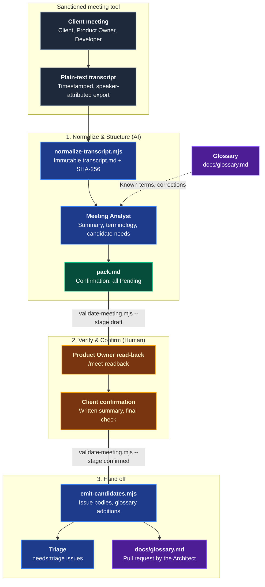
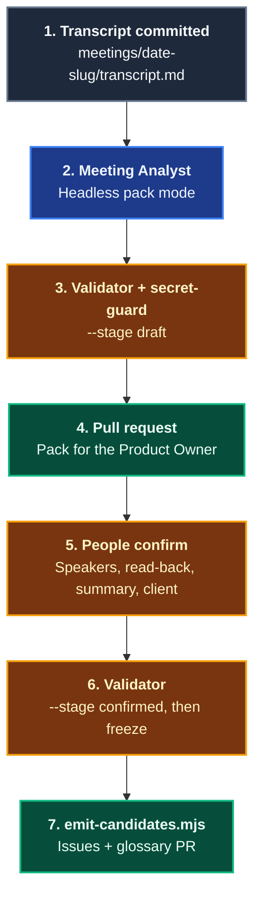

# Meet

The **Meet** domain turns client conversations into an immutable **Meeting Pack**: a normalized transcript, a one-page summary, domain terminology, and candidate business needs anchored in verbatim client quotes. It implements stage [0 — Meet](https://alten-group.github.io/agentic-software-factory/guide/stage-meet) of the Agentic Software Factory and feeds the [Triage](./domain-triage.md) domain.

Recording and speech-to-text belong to the sanctioned meeting intelligence tool. Coding Pal starts from its **plain-text transcript**, normalizes it, structures it, and validates it. AI structures the dialogue. People verify the speakers, read the needs back, and the client confirms them. Coding Pal enforces that split mechanically: an AI-produced pack can never carry a confirmation, and a confirmed pack must name the people who gave it.

---

## Domain Architecture



---

## Capabilities Matrix

| Capability | Invocation / Entry Point | Specialist Agent | Scoping Instruction | Supporting Skill | Output Artifact |
|---|---|---|---|---|---|
| **Transcript to Meeting Pack** | [`/meet`](./catalog-prompts.md#_11-meet) or the [`Meeting Analyst`](./catalog-agents.md#_12-meeting-analyst-meeting-pack-agent-md) in CI | [`Meeting Analyst`](./catalog-agents.md#_12-meeting-analyst-meeting-pack-agent-md) | [`meeting-pack`](./catalog-instructions.md#meeting-pack-instructions) | [`meeting-pack`](./catalog-skills.md#_19-meeting-pack-skills-meeting-pack) | `meetings/<date>-<slug>/transcript.md` and `pack.md` |
| **Read-Back List** | [`/meet-readback`](./catalog-prompts.md#_12-meet-readback) | [`Meeting Analyst`](./catalog-agents.md#_12-meeting-analyst-meeting-pack-agent-md) (read-back mode) | [`meeting-pack`](./catalog-instructions.md#meeting-pack-instructions) | [`meeting-pack`](./catalog-skills.md#_19-meeting-pack-skills-meeting-pack) | Needs, quotes, terms, and open questions for the Product Owner (no files written) |
| **Handoff to Triage** | CI after confirmation (`emit-candidates.mjs`) | None (deterministic) | [`meeting-pack`](./catalog-instructions.md#meeting-pack-instructions) | [`meeting-pack`](./catalog-skills.md#_19-meeting-pack-skills-meeting-pack) | Backlog issue bodies, `candidates.json`, `glossary-additions.md` |

---

## The Meeting Pack

| Part | File | Content |
|---|---|---|
| **Transcript** | `transcript.md` | Header (date, tool, source file, recording consent, duration), a speakers table (name, role, `client`/`internal`), and `[HH:MM:SS] Name: text` lines. Immutable. |
| **Executive summary** | `pack.md` | Business drivers, urgency, and core challenges on one page |
| **Domain concepts & terminology** | `pack.md` | Terms with how they were heard, a definition, a status (`known`, `new`, `correction`), and the timestamp |
| **Candidate business needs** | `pack.md` | Problem statement, verbatim evidence quotes (`Name (Role)` and timestamp), draft acceptance criteria, and concepts |
| **Confirmation** | `pack.md` | Speaker verification, client read-back, written summary sent, and client confirmation, each by a named person |

The glossary is `docs/glossary.md` (Term, Definition, Aliases, Source). It is Persistent Context owned by the Architect.

---

## Capability Workflows

### 1. Transcript to Meeting Pack

- **When to Run**: After every client or stakeholder meeting. Interactively in the IDE (`/meet exports/acme-call.txt`) or headlessly in CI.
- **Why a Contract**: "AI transcribed the call" is not evidence by itself. A fixed structure, a recorded digest, and verbatim, client-attributed quotes mean every later stage can be checked against the original words, and a validator can reject what a model cannot be trusted to self-police.
- **Workflow Steps**:
  1. **Record**: The sanctioned meeting tool records the meeting and exports a plain-text transcript. Consent is recorded.
  2. **Normalize**: `normalize-transcript.mjs` converts the export to `transcript.md` using a roster (name, role, side for every speaker) and prints its SHA-256. It refuses to overwrite an existing transcript.
     ```bash
     node .agents/skills/meeting-pack/scripts/normalize-transcript.mjs --input exports/acme-call.txt \
       --roster roster.json --title "Acme discovery call" --date 2026-09-24 --tool "<meeting tool>" \
       --consent "Yes - announced at the start of the call" \
       --output meetings/2026-09-24-acme-discovery/transcript.md
     ```
  3. **Structure**: The `Meeting Analyst` reads the transcript and `docs/glossary.md`, then drafts the summary, the terminology table, and the candidate needs.
  4. **Validate (draft)**:
     ```bash
     node .agents/skills/meeting-pack/scripts/validate-meeting.mjs \
       --dir meetings/2026-09-24-acme-discovery --glossary docs/glossary.md
     ```
  5. **Read back and confirm**: A person verifies speaker accuracy. The Product Owner reads the needs back to the client, the written summary is sent, and the client confirms or corrects. These are recorded by name in the pack.
  6. **Validate (confirmed)**, then freeze: `--stage confirmed`. CI rejects later edits to the meeting files.
  7. **Hand off**: `emit-candidates.mjs` produces one backlog issue body per need, and stages new terms and aliases for the glossary.

#### What the Validator Enforces

| Check | Why |
|---|---|
| Consent recorded, speakers declared with name, role, and side, timestamps never backwards | A trustworthy source |
| The pack's SHA-256 matches `transcript.md` | The transcript is immutable |
| Every quote is a verbatim substring of that speaker's line at that timestamp, with `Name (Role)` matching the speakers table | No fabricated or paraphrased client words |
| Every need has at least one client-side quote | Evidence is the client's, not internal staff's |
| `known`/`new`/`correction` terms agree with the glossary, and `Heard As` appears in the transcript | Terminology is honest and traceable |
| Summary within one page, draft criteria are `Given ..., then ...` (at least 3 words after `then`) and at most 8 | Short, structured, testable |
| Each `- **Label:**` field appears once in the transcript header and the pack's Meeting, Summary, and Confirmation sections | A duplicate must not silently win |
| `normalize-transcript.mjs --force` is refused once a sibling `pack.md` exists | The pack records the transcript's digest |
| `draft`: all confirmations `Pending` | AI never confirms |
| `confirmed`: named participants (never an AI), read-back by the Product Owner, summary sent to and confirmation by a client-side participant, valid dates | Human accountability |
| Warning when no Product Owner or Developer attended | Cadence rule: a Developer attends |

#### Handoff to Triage

`emit-candidates.mjs --dir <meeting dir> --out <dir>` requires a confirmed pack and writes:
- `candidate-N<k>.md`: the issue body, starting with `<!-- meeting-candidate: <dir>#N<k> -->` so CI can skip duplicates (`<dir>` is relative to the git repository root; stale `candidate-N*.md` files in the output directory are deleted first), with an evidence table in the [Triage](./domain-triage.md) contract's format.
- `candidates.json`: title, labels (`needs:triage`, `source:meeting`), marker, and body file.
- `glossary-additions.md`: new terms and aliases for a pull request to `docs/glossary.md`.

The Triage Analyst reuses the evidence rows, validates the candidate's pack, and uses the transcript as `--source`.

#### CI Pattern



### 2. Read-Back List

- **When to Run**: During or right after the meeting, before it ends.
- **Workflow**: `/meet-readback <transcript>` gives the Product Owner each need as one sentence in the client's words, with the best verbatim quote, speaker and timestamp, terms to confirm against the glossary, and open questions. It writes nothing and confirms nothing.

- **Falsifiable Done When**:
  - `transcript.md` is unchanged from the normalizer's output, and the pack's digest matches it.
  - `pack.md` passes `validate-meeting.mjs --stage draft` with `--glossary`, exit code 0.
  - Every confirmation is `Pending` until people complete them.
  - Zero code files or glossary rows were modified.

---

## Related Catalogs & Schemas

- [Prompts Catalog](./catalog-prompts.md)
- [Agents Catalog](./catalog-agents.md)
- [Instructions Catalog](./catalog-instructions.md)
- [Skills Catalog](./catalog-skills.md)
- [Persistent Context Architecture](./persistent-context.md)
- [Triage Domain](./domain-triage.md)
