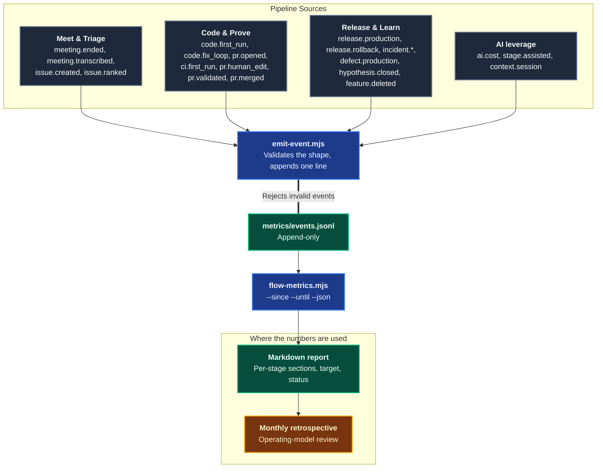
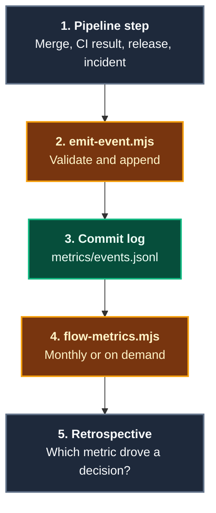

# Flow Metrics

The **Flow Metrics** domain computes the [Agentic Software Factory's metrics](https://alten-group.github.io/agentic-software-factory/guide/metrics) from an append-only event log. The factory measures a deliberately small set of things, each because a decision depends on it, and Coding Pal makes that set computable without anyone timing work by hand.

Pipelines emit events with timestamps they already record. A deterministic script turns the log into a report with each metric's value, the factory's target, and a status. The same log always gives the same report.

---

## Domain Architecture



---

## Capabilities Matrix

| Capability | Invocation / Entry Point | Specialist Agent | Scoping Instruction | Supporting Skill | Output Artifact |
|---|---|---|---|---|---|
| **Record an event** | `node .agents/skills/flow-metrics/scripts/emit-event.mjs` from a pipeline step | none (deterministic) | none | [`flow-metrics`](./catalog-skills.md) | One validated line in `metrics/events.jsonl` |
| **Compute the report** | `node .agents/skills/flow-metrics/scripts/flow-metrics.mjs` in CI or the retrospective | none (deterministic) | none | [`flow-metrics`](./catalog-skills.md) | Markdown or JSON report with per-stage sections |

---

## Capability Workflows

### 1. Record an Event

- **When to Run**: At the moment a pipeline step ends: the meeting transcript is ready, the issue is ranked, the first Code run finishes, the first CI run finishes, a pull request is merged, production exposure changes, an incident is opened or mitigated, a hypothesis is closed.
- **Why a Contract**: A metric nobody can reproduce is an opinion. A fixed event shape means a typo in a field, a wrong timestamp, or an unknown event type is rejected at the moment it is written, not discovered in a retrospective.
- **Workflow Steps**:
  ```bash
  node .agents/skills/flow-metrics/scripts/emit-event.mjs --log metrics/events.jsonl \
    --type code.first_run --id issue-42 --field green=true
  node .agents/skills/flow-metrics/scripts/emit-event.mjs --log metrics/events.jsonl \
    --type release.production --id issue-42 --field percent=100
  node .agents/skills/flow-metrics/scripts/emit-event.mjs --log metrics/events.jsonl \
    --type ai.cost --id issue-42 --field usd=1.25 --field stage=code --field change=issue-42
  ```
  The line written is `{"t":"2026-10-13T09:30:00Z","type":"code.first_run","id":"issue-42","green":true}`. The timestamp defaults to now in UTC; pass `--t` to record a past moment.

#### Event Types

| Type | `id` is | Fields |
|---|---|---|
| `meeting.ended`, `meeting.transcribed` | meeting directory | none |
| `issue.created`, `issue.ranked` | work item | `meeting` (optional link to the meeting) |
| `code.first_run`, `ci.first_run` | work item | `green` |
| `code.fix_loop` | work item | `count` |
| `pr.opened`, `pr.human_edit`, `pr.merged`, `pr.reworked` | work item | none |
| `pr.validated` | work item | `tier`, `ci_green_at` (optional) |
| `release.production` | work item | `percent` (0 to 100) |
| `release.rollback`, `feature.deleted`, `evidence.first_signal` | work item | none |
| `incident.opened` | incident | `change` (optional: the work item that caused it) |
| `incident.mitigated` | incident | none |
| `defect.production` | defect | `escaped` |
| `hypothesis.closed` | work item | `verdict` (`validated`, `invalidated`, `inconclusive`) |
| `ai.cost` | work item | `usd`, `stage`, `change` |
| `stage.assisted` | work item | `stage`, `share` (0 to 1) |
| `context.session` | work item | `hit` |
| `pr.authorship` | work item | `ai_lines`, `human_lines` (integers, at least one positive) |
| `usecase.run` | work item | `usecase`, `minutes`, `iterations` (>= 1), `usd`, `human_intervention`, `first_pass` |

`id` is lowercase (`issue-42`, `2026-09-24-acme-discovery`, `incident-3`). `t` is an ISO 8601 UTC timestamp. Unknown fields are rejected.

#### What the Emitter Enforces

| Check | Why |
|---|---|
| `t` is a valid UTC timestamp | Durations are computed from it |
| `type` is one of the 25 known events | A misspelled event silently drops out of a metric |
| Required fields present with the right type (`green` is true or false, `percent` is 0 to 100, `tier` is a blast radius tier) | A malformed value would corrupt a rate or a median |
| No unknown fields | The contract stays small and reviewable |
| One JSON object per line, appended | The log is a history, not a document |

### 2. Compute the Report

- **When to Run**: Before the weekly reviews and the monthly operating-model retrospective, or on every merge to keep a dashboard fresh.
- **Workflow**:
  ```bash
  node .agents/skills/flow-metrics/scripts/flow-metrics.mjs \
    --events metrics/events.jsonl --since 2026-09-01 --until 2026-09-30
  node .agents/skills/flow-metrics/scripts/flow-metrics.mjs --events metrics/events.jsonl --json
  ```
- **Period**: An outcome event decides whether a work item is in the period. A lead time belongs to the period of the 100% release, even when the meeting was earlier.
- **Empty or missing**: An empty log gives `unknown` for every metric (exit 0). A missing file, or a line that is not a valid event, exits 1 with the line number.

An excerpt of a report:

```markdown
## Flow

| Metric | Value | Target | Status | n |
|---|---|---|---|---|
| Meeting-to-Production lead time (median) | 60 hours | < 48 | warn | 2 |
| Deployment frequency | 0.7 per week | >= 14 (multiple daily) | warn | 1 |
| Change failure rate | 50% | < 1% | warn | 2 |
| Time to restore (median) | 10 minutes | < 15 | ok | 1 |
```

#### Metrics and Thresholds

Status is `ok` (meets the target, or the metric is trend-only), `warn` (misses it), or `unknown` (no events).

| Stage | Metric | Formula in short | Target |
|---|---|---|---|
| Flow | Meeting-to-Production lead time | Median hours, `meeting.transcribed` to first 100% `release.production` | `< 48` hours |
| Flow | Deployment frequency | 100% releases per week | `>= 14` per week (2 a day) |
| Flow | Change failure rate | Released work items with a rollback or incident / released work items | `< 1%` |
| Flow | Time to restore | Median minutes, `incident.opened` to `incident.mitigated` | `< 15` minutes |
| Meet & Triage | Hours from meeting end to ranked backlog issue | Median hours, `meeting.ended` to `issue.ranked` | `<= 8` hours |
| Code | First-pass green rate | `code.first_run` green / work items | `>= 80%` |
| Code | Fix-loop count | Mean of the latest `code.fix_loop` per work item | `<= 3` |
| Prove | Deterministic control pass rate | `ci.first_run` green / work items | `>= 80%` |
| Prove | Human rework rate | Merged work items with `pr.human_edit` / merged | `0%` |
| Prove | Acceptance rate and rework rate (14 days) | Settled merged changes without / with rework | trend |
| Prove | Minimum human validation turnaround | Median hours from CI green to `pr.validated`, by tier | trend |
| Learn | Hypothesis validation rate | Validated / closed hypotheses | `< 95%`: 95% or more with at least 5 closed hypotheses warns (our reading of "close to 100%") |
| Learn | Feature deletion rate | Invalidated features deleted within the cycle (14 days) | `100%` |
| Learn | Time to evidence | Median hours, `issue.created` to `evidence.first_signal` | trend |
| Learn | Escaped defect rate | Defects found in production / all defects | trend |
| AI leverage | AI code generation share | `ai_lines` / (`ai_lines` + `human_lines`) summed over `pr.authorship` | `100%` (zero human syntax typing) |
| AI leverage | Assisted share per stage | Mean `share` per stage | trend; warns if only Code has any |
| AI leverage | Context hit rate | `context.session` hits / sessions | trend |
| AI leverage | Cost per merged change | `ai.cost` `usd` / merged work items, by stage | trend |

Trend-only metrics never warn: the factory states a direction, not a threshold. A `warn` is an invitation to improve Persistent Context, controls, or Plan quality, not to press people. A fix-loop count above 3 means the work item was too big or too vague when it left Plan.

Two targets are interpretations of qualitative wording on the factory's metrics page. "Multiple daily deployments" is read as at least 2 production deployments per day on average over the report period (14 per week). "A validation rate close to 100%" is read as 95% or more with at least 5 closed hypotheses. Change the numbers in the contract if the operating model decides otherwise.

#### Metrics per Use Case

A use case is one AI-assisted task inside a stage. Each `usecase.run` event records, for one work item, the time spent (`minutes`), `iterations`, cost (`usd`), `human_intervention`, and `first_pass`. The report adds a per-use-case table:

```markdown
## Per Use Case

| Use case | Runs | Median minutes | Mean iterations | Mean USD | Human intervention | First-pass success | Target | Status |
|---|---|---|---|---|---|---|---|---|
| automated-test-creation | 2 | 30 | 2 | 1 | 50% | 50% | median <= 30 minutes | ok |
| backlog-issue-creation | 0 | - | - | - | - | - | median <= 8 hours | unknown |
| controls-first-run | 0 | - | - | - | - | - | first-pass rate >= 80% | unknown |
| fix-loop | 1 | 9 | 4 | 0.25 | 0% | 0% | mean iterations <= 3 | warn |
| time-to-restore | 0 | - | - | - | - | - | median < 15 minutes | unknown |
```

The five use cases from the factory's metrics page (`automated-test-creation`, `fix-loop`, `backlog-issue-creation`, `controls-first-run`, `time-to-restore`) are always listed, with the target that page states for each. Any other `usecase` slug found in the log is added as a trend-only row with no target. A use case with no run is `unknown`.

#### Deliberately Not Measured

| Not measured | Why |
|---|---|
| Lines of code | AI makes it meaningless and perverse |
| Story points velocity | Measures estimation, not value |
| Assistant suggestion acceptance in the editor | Correlates with nothing that matters |

There is no event type for them and the script never computes them.

Some factory measures are not computed from events: cost per squad (the platform cost dashboard), coverage on changed lines (the pipeline's coverage gate), and review depth (the pull request record). The factory measures flow per squad over rolling four-week windows: run the report on each squad's own log with `--since` set four weeks back.

`pr.authorship` records lines only to attribute them to AI or to a person. The report shows the share, never a line count, so it does not turn lines of code into a productivity measure.

#### CI Pattern



1. **Append only**: A wrong event is countered by a later one, or removed through a reviewed pull request. The log is never regenerated.
2. **Metrics are reviewed, too**: The monthly retrospective reviews the values and the list itself. A metric that has not driven a decision in two quarters is removed from the contract.

- **Falsifiable Done When**:
  - Every emitted event passed `emit-event.mjs` with exit code 0.
  - `flow-metrics.mjs` exits 0 on the whole log and prints a section per stage, including on an empty log.
  - The report contains no lines-of-code, story-point, or suggestion-acceptance figure.

---

## Related Catalogs & Schemas

- [Skills Catalog](./catalog-skills.md)
- [Persistent Context Architecture](./persistent-context.md)
- [Governance & Decisions Domain](./domain-governance.md)
- [Triage Domain](./domain-triage.md)
- [Code Domain](./domain-code.md)
- [Prove Domain](./domain-prove.md)
- [Release Domain](./domain-release.md)
- [Learn Domain](./domain-learn.md)
