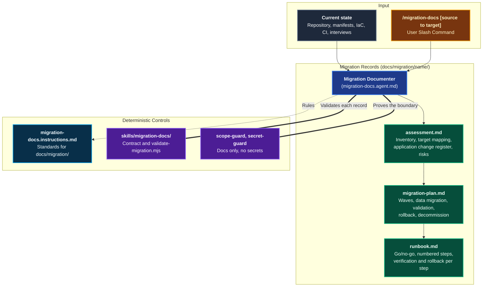

# Migration

The **Migration** domain produces the documentation for moving an application or platform from one infrastructure to another. The common case is on-premise to cloud, but any move works: cloud to cloud, datacenter to datacenter, or cloud back to on-premise.

It focuses on the migration, not on the application. The infrastructure absorbs the difference wherever it can. The application changes only when nothing else works, and every such change is registered, justified, and bounded by a declared **Change Budget**. AI documents and proposes. The Architect decides the strategy, and DevOps approves the cutover.

> [!TIP]
> To produce forward-looking specifications for new features, see [Think & Plan](./domain-think-plan.md). To reverse-engineer API and schema specifications from existing code, see [Specs & Docs](./domain-docs.md).

---

## Domain Architecture



---

## Capabilities Matrix

| Capability | Invocation / Entry Point | Scoping Instruction | Supporting Skill | Output Artifact |
|---|---|---|---|---|
| **Migration Documentation** | [`/migration-docs`](./catalog-prompts.md#_20-migration-docs) | [`migration-docs`](./catalog-instructions.md#migration-instructions) | [`migration-docs`](./catalog-skills.md#_38-migration-docs-skills-migration-docs) | `docs/migration/<name>/assessment.md`, `migration-plan.md`, `runbook.md` |

---

## Capability Workflow

### Migration Documentation

- **When to Run**: A decision to move an application or platform has been made and the move must be assessed, planned, and rehearsed in writing.
- **Trigger**: `/migration-docs [source to target] [docs-dir]`
- **Agent**: [`Migration Documenter`](./catalog-agents.md#_19-migration-documenter-migration-docs-agent-md) (`migration-docs.agent.md`)
- **Execution Methodology**:
  1. Fixes the source, the target, the driver, and the Change Budget with the user.
  2. **Assessment**: inventories every component from the repository and manifests with evidence, maps each to a target and a strategy, and registers each application change.
  3. **Plan**: groups the migrated components into dependency-ordered waves, then defines data migration, connectivity and identity, validation checks, rollback, and decommissioning.
  4. **Runbook**: turns each wave into numbered steps with owner, action, verification, rollback, and duration, plus the go/no-go criteria and the post-cutover handover.
- **Falsifiable Done When**:
  - The records pass the skill validator, including the cross-checks between them:
    ```bash
    node .agents/skills/migration-docs/scripts/validate-migration.mjs --dir docs/migration/<name>
    ```
  - `scope-guard --scope "docs/migration/**"` and `secret-guard` exit with code 0.

---

## Keeping Application Changes Minimal

The assessment declares one Change Budget and stays inside it.

| Budget | Allowed application impact |
|---|---|
| `none` | Nothing. The register is empty. |
| `config-only` (default) | Environment variables, connection strings, endpoints, feature flags, deployment descriptors. |
| `minimal-code` | Configuration, build and packaging, and the smallest code change that closes a gap. |

A gap is closed by the first option that works:

1. **Infrastructure side**: network route, DNS, proxy, VPN or private link, wire-compatible managed service, sidecar, adapter.
2. **Configuration**: externalized settings and secret references.
3. **Build and packaging**: base image, runtime version, container manifest, CI target.
4. **Code**: only when the options above fail.

Strategies follow the same bias: `Rehost` and `Relocate` first, `Replatform` when a managed equivalent removes operations work without code change, and `Refactor` only with a drafted decision record that the Architect signs.

---

## The Three Records

| Record | Answers | Key content |
|---|---|---|
| `assessment.md` | What do we have, where does each piece go, and what must change in the application? | Scope and Change Budget, source inventory with evidence, target mapping, application change register, risks, open questions |
| `migration-plan.md` | In which order, with which data movement, validation, and rollback? | Waves with downtime budgets, data migration per stateful component, connectivity and identity, validation checks, rollback per wave, point of no return, decommissioning |
| `runbook.md` | Which exact steps does the cutover team execute? | Go/no-go criteria, numbered steps with owner, action, verification, rollback, and duration, post-cutover hypercare and handover |

Each record derives from the previous validated one. The validator rejects, among other things:

- an inventory component without evidence or without exactly one target mapping;
- an application change outside the Change Budget, or a mapping impact that disagrees with the change register;
- a migrated component missing from the waves, or moving before a component it depends on;
- a migrated database or storage component without a data migration row;
- a wave without a validation check or a rollback row;
- a runbook step without a verification, or a rollback gap before the declared point of no return;
- a secret value anywhere in the records.

---

## Related Catalogs & Schemas

- [Think & Plan Domain](./domain-think-plan.md)
- [Governance & Decisions Domain](./domain-governance.md)
- [Controls & Safeguards Domain](./domain-controls.md)
- [Prompts Catalog](./catalog-prompts.md)
- [Agents Catalog](./catalog-agents.md)
- [Instructions Catalog](./catalog-instructions.md)
- [Skills Catalog](./catalog-skills.md)
