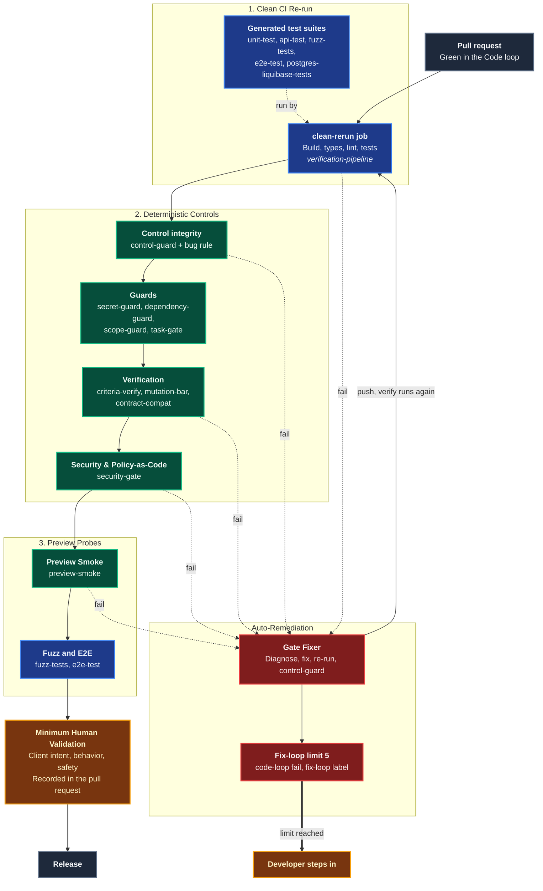
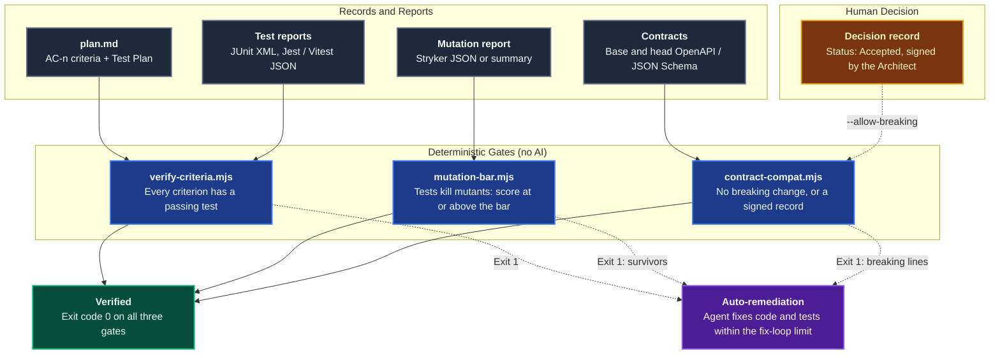
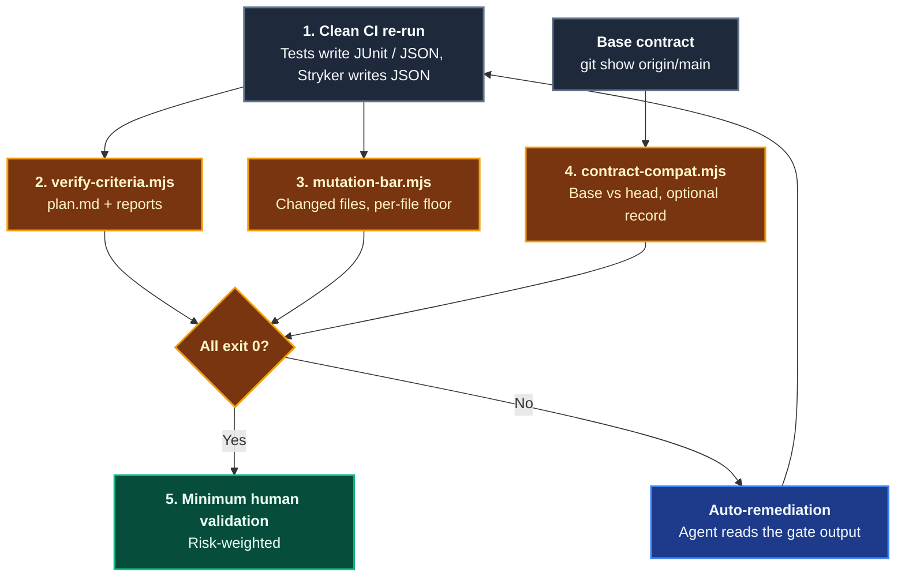
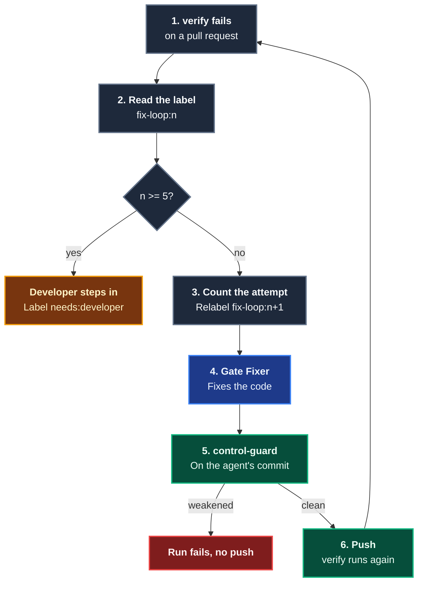

# Prove

The **Prove** domain is the fifth stage of the [Agentic Software Factory](https://alten-group.github.io/agentic-software-factory/guide/stage-prove). It combines **dense deterministic controls** with **minimum human validation**, so that generated software is proven correct and safe without anyone reading diffs line by line.

Controls decide. Agents write the tests and repair failures. Humans validate client intent, behavior, and safety at the level the blast radius requires (see [Code](./domain-code.md)). Coding Pal ships each control as a skill, so the same script runs in the agent's loop and again in CI.

Verification gates (criteria, mutation, contract) read the report files that tools already produced. Safety, preview probes, the pipeline, the remediation loop, and the Platform Rails complete the domain. All of it is on this page.


## Domain Architecture



---

## The Controls and the Skills That Implement Them

The table follows the [Prove stage](https://alten-group.github.io/agentic-software-factory/guide/stage-prove) of the factory. Skills marked **new** were added for Prove.

| Control | Type | Coding Pal skill | What it proves |
|---|---|---|---|
| **Clean CI Re-run** | Gate | `verification-pipeline` (**new**, `verify.yml` job `clean-rerun`) and `task-gate` | Build, type check, lint, and tests pass where the agent cannot influence the result |
| **Criteria Test Verification** | Gate | `criteria-verify` (**new**, [details](#_1-criteria-test-verification)) | Every acceptance criterion has a passing test |
| **Contract & Schema Compatibility** | Contract | `contract-compat` (**new**, [details](#_3-contract-schema-compatibility)) and `contract-validator` | Public interfaces do not break silently |
| **Mutation Testing Bar** | Gate | `mutation-bar` (**new**, [details](#_2-mutation-testing-bar)) | The tests catch injected defects |
| **API Tests** | Contract | `api-test` agent and `node-express-examples` | Each endpoint returns the agreed statuses and bodies |
| **Fuzz Tests** | Probe | `fuzz-tests` agent and `restler-fuzzing-examples` | The API survives malformed input |
| **Database Tests** | Gate | `postgres-liquibase-examples` (`postgres-liquibase-tests` prompt) | Schema and migrations behave as specified |
| **E2E Tests** | Probe | `e2e-test` agent | The main journeys work on the running application |
| **Unit Tests** | Gate | `unit-test` agent | Generated code behaves as specified (run by the clean re-run) |
| **Security & Policy-as-Code** | Guard | `security-gate` (**new**), `secret-guard`, `dependency-guard` | No known vulnerabilities, secrets, policy violations, or unapproved licenses |
| **Control integrity** | Guard | `control-guard` (**new**) | No control was weakened to get a pass |
| **The bug rule** | Guard | `control-guard` (`bug-rule.mjs`, **new**) and `test-probe` | The failing check was committed before the fix, and it fails without it |
| **Preview Smoke Tests** | Probe | `preview-smoke` (**new**) | The application starts, routes traffic, and answers health checks |
| **File scope** | Guard | `scope-guard` | The change stays inside the Plan's file scope |
| **Platform Rails** | Rails | `verification-pipeline` (**new**, `rails-check.mjs`) | The repository has the pipeline, the remediation loop, and the controls installed |

---

## Capabilities Matrix

| Capability | Invocation / Entry Point | Specialist Agent | Scoping Instruction | Supporting Skill | Output |
|---|---|---|---|---|---|
| **Criteria test verification** | `node .agents/skills/criteria-verify/scripts/verify-criteria.mjs` in the agent loop and CI | none (script) | [`prove-controls`](./catalog-instructions.md) | [`criteria-verify`](./catalog-skills.md) | Markdown table: criterion, tests, verdict. Exit 0 only when every criterion passes |
| **Mutation testing bar** | `node .agents/skills/mutation-bar/scripts/mutation-bar.mjs` in the agent loop and CI | none (script) | [`prove-controls`](./catalog-instructions.md) | [`mutation-bar`](./catalog-skills.md) | Score, per-file table, survivors as `file:line mutator`. Exit 1 below the bar |
| **Contract & schema compatibility** | `node .agents/skills/contract-compat/scripts/contract-compat.mjs` in the agent loop and CI | none (script) | [`prove-controls`](./catalog-instructions.md) | [`contract-compat`](./catalog-skills.md) | One `BREAKING` or `compatible` line per change. Exit 1 on any breaking change without an Accepted, signed record |
| **Security & license gate** | CI, or `node .agents/skills/security-gate/scripts/security-gate.mjs` | none (script) | [`prove-controls`](./catalog-instructions.md) | [`security-gate`](./catalog-skills.md) | Pass or fail, with waived findings listed |
| **Control integrity and bug rule** | CI, after every agent fix, or `control-guard.mjs` and `bug-rule.mjs` | none (scripts) | [`prove-controls`](./catalog-instructions.md) | [`control-guard`](./catalog-skills.md) | `RULE file:line message` findings, commit order |
| **Preview smoke** | CI `preview` job, or `preview-smoke.mjs` | none (script) | [`prove-controls`](./catalog-instructions.md) | [`preview-smoke`](./catalog-skills.md) | Per-route pass or fail |
| **Delivery pipeline and Platform Rails** | Copy the templates, then `rails-check.mjs` | none (templates and script) | [`prove-controls`](./catalog-instructions.md) | [`verification-pipeline`](./catalog-skills.md) | `verify.yml`, `remediate.yml`, missing rails |
| **Agent auto-remediation** | [`/fix-gates`](./catalog-prompts.md) or the [`Gate Fixer`](./catalog-agents.md) in CI | [`Gate Fixer`](./catalog-agents.md) | [`prove-controls`](./catalog-instructions.md) | `control-guard`, `code-loop` | A fix commit that passes the failed control, or a hand-over |

---

## Capability Workflows


The three verification gates are zero-dependency Node scripts. They consume report files, run no third-party tool, and need no network. The agent writes the tests, so a model re-reading its own work proves nothing: these gates return the same verdict for the same input, whatever model wrote the code. The agent can run them but can never edit them, skip a test, or lower a bar to get a pass.



### 1. Criteria Test Verification

- **When to Run**: After a Code step finishes its tests, to see which acceptance criteria are still open. Again in CI on the pull request, against the clean re-run's reports.
- **Why a Gate**: A green test run does not mean the *right* things were tested. The Plan record lists the criteria the Product Owner and Developer agreed. This gate proves each has a passing test.
- **Workflow Steps**:
  1. **Name**: The agent names each test after the criterion it verifies, for example `it("AC-2 rejects viewers", ...)`. The Test Plan table in `plan.md` already lists the test file per criterion.
  2. **Report**: The test runner writes JUnit XML or Jest/Vitest JSON.
  3. **Verify**:
     ```bash
     node .agents/skills/criteria-verify/scripts/verify-criteria.mjs \
       --plan specs/issue-42/plan.md \
       --report reports/jest.json --report reports/api-junit.xml --require-test-files
     ```
  4. **Read the table**: each criterion is `PASS`, `FAIL`, `NOT COVERED`, `NOT PASSING`, or `TEST FILE NOT REPORTED`, with the reason listed below the table. Tests that map to no criterion are listed as information.

#### What the Gate Enforces

| Check | Why |
|---|---|
| A test maps to a criterion only by a word-bounded `AC-<n>` token (case-insensitive) in its name, title, full name, or class name | Explicit and auditable: `AC-1` never matches `AC-12` |
| Every criterion needs at least one passing mapped test | The Plan record is the definition of done |
| One failed mapped test fails the criterion, even when a sibling passes | A failing assertion is never offset |
| Skipped and pending tests do not count | `it.skip` verifies nothing |
| `--require-test-files`: each Test Plan test file appears among the reported files | The planned test was actually run, not replaced by another |
| An empty or unrecognized report is an error | No report, no proof |
| Unknown arguments are errors | A mistyped flag cannot silently weaken the gate |

### 2. Mutation Testing Bar

- **When to Run**: In the agent loop with `--changed` on the files of the current step. In CI on the whole report or on the pull request's changed files.
- **Why a Gate**: Coverage tells which lines ran. A mutation tool injects small defects (a flipped condition, a removed statement) and re-runs the tests. A mutant that no test catches is a **survivor**, and proves a test that asserts too little.
- **Workflow Steps**:
  1. **Mutate**: The project's mutation tool writes a Stryker JSON report. A generic summary is also accepted for tools such as Mutmut.
  2. **Gate**:
     ```bash
     node .agents/skills/mutation-bar/scripts/mutation-bar.mjs \
       --report reports/mutation/mutation.json --changed changed.txt --per-file-min 60
     ```
  3. **Kill survivors**: The output lists each survivor as `src/routes/role.js:40 ConditionalExpression (Survived)`. The agent adds or strengthens assertions until they are killed.

Score = `(killed + timeout) / (killed + timeout + survived + noCoverage) * 100`. `CompileError`, `RuntimeError`, and `Ignored` mutants are excluded, but their number is printed, so a survivor hidden with a `Stryker disable` comment stays visible. With `--changed`, a changed file with no mutants in the report prints `Warning: no mutants for <file>: not proven` (the exit code is unchanged).

#### What the Gate Enforces

| Check | Why |
|---|---|
| Score at or above the minimum (default 80) | Generated tests must be meaningful, not just present |
| `mutation-bar.json` may set `minScore` and `perFileMin`; the command line can only **raise** them | `a control cannot be weakened`: the agent cannot lower the bar |
| `--changed` scores only the changed files | A pull request is judged on its own code, not on the legacy |
| `--per-file-min` fails a weak file even when the total passes | A strong file cannot hide a weak one |
| Nothing scorable in the scope fails | A change that was not mutation tested cannot pass |
| Unfinished runs (a `Pending` mutant) are an error | An incomplete run proves nothing |
| `--changed` and a per-file minimum need a Stryker report | A summary carries no per-file data |

### 3. Contract & Schema Compatibility

- **When to Run**: Before committing a change to an API contract or schema, and in CI with the base taken from the target branch.
- **Why a Gate**: A removed field or a new required parameter breaks a consumer you cannot see. The factory treats a breaking public contract as **Critical**: it needs a decision record that the Architect signs and a staged rollout.
- **Workflow Steps**:
  1. **Export both sides as JSON**:
     ```bash
     git show origin/main:openapi.json > base.json
     ```
  2. **Compare**:
     ```bash
     node .agents/skills/contract-compat/scripts/contract-compat.mjs --base base.json --head openapi.json
     ```
  3. **Fix or escalate**: The agent restores compatibility (keeps the old field, makes the new one optional, adds a new version). For an intended break, the Architect signs a decision record and the check is rerun with `--allow-breaking docs/decisions/0007-remove-legacy-role.md`.

```
BREAKING GET:/users/{id} response 200 application/json address.zip: property removed
BREAKING POST:/users request body application/json role: property is now required
compatible GET:/users new optional parameter query:q
```

#### What the Gate Enforces

| Area | Breaking | Compatible |
|---|---|---|
| Operations and responses | A path, operation, or declared response status is removed | New paths, operations, response statuses |
| Response schema | A property is removed or retyped, an enum value is added (clients never saw it), a property stops being guaranteed, a schema is dropped from a media type | New response properties, removed enum values |
| Request | A new required parameter or body property, a parameter made required or moved, a retyped property, a removed enum value, tightened bounds, `additionalProperties: false` on an open schema | New optional parameters and properties, added enum values, relaxed bounds |
| Security | A security requirement is added to an operation, or a used alternative is dropped | Another alternative, or security removed |
| `--allow-breaking` | Accepted only when the record exists, its `Status` is `Accepted`, and its `Signature` is `Signed by <name> (Architect) on YYYY-MM-DD` with a person's name and a real date | `Drafted` and unsigned records, and records signed by any other role or by an AI name, release nothing |

Local `$ref` is resolved, `allOf` is merged, and cyclic references are handled. YAML, Swagger 2.0, and external `$ref` are not supported: convert to JSON and bundle first. Pact consumer contracts are out of scope today and are a candidate for a future adapter.

### 4. Verification Gates in CI

The gates run in the same pull request workflow, after the clean CI re-run has produced the reports.



```yaml
- name: Criteria Test Verification
  run: >
    node .agents/skills/criteria-verify/scripts/verify-criteria.mjs
    --plan specs/issue-${{ env.ISSUE }}/plan.md
    --report reports/jest.json --require-test-files
- name: Mutation Testing Bar
  run: |
    git diff --name-only origin/main... > changed.txt
    node .agents/skills/mutation-bar/scripts/mutation-bar.mjs \
      --report reports/mutation/mutation.json --changed changed.txt
- name: Contract & Schema Compatibility
  run: >
    node .agents/skills/contract-compat/scripts/contract-compat.mjs
    --base base.json --head openapi.json
```

1. **Gate output feeds remediation**: the failing table, the survivor list, or the `BREAKING` lines are exactly what the agent reads.
2. **Never weakened**: the agent does not edit these scripts, `mutation-bar.json`, the base contract, or the Test Plan to obtain a pass. Protect those paths with CODEOWNERS.
3. **Fix-loop limit**: when remediation reaches the limit set in Code, the Developer steps in.

- **Falsifiable Done When**:
  - `verify-criteria.mjs` exits 0: every `AC-<n>` has a passing mapped test and no mapped test failed.
  - `mutation-bar.mjs` exits 0: the score meets the minimum (80 or the configured value) and no survivor was excluded.
  - `contract-compat.mjs` exits 0 with no `BREAKING` line, or every `BREAKING` line is covered by an `Accepted` decision record signed by a named Architect.
  - No control, report, or contract file was edited to obtain the verdict.

### 5. Security & Policy-as-Code Gate

- **When to Run**: In the agent's loop whenever scanner output exists, and in CI on every pull request.
- **Why a Gate**: A scanner prints findings, a gate decides. The gate fixes the severity bar, the license policy, and the waiver rules, so an agent cannot reinterpret them.
- **Workflow Steps**:
  1. Run the scanners (Semgrep, Trivy, CodeQL with SARIF output, Conftest with JSON output, an SBOM generator for CycloneDX).
  2. Run the gate:
     ```bash
     node .agents/skills/security-gate/scripts/security-gate.mjs \
       --sarif reports/semgrep.sarif --conftest reports/conftest.json \
       --sbom reports/sbom.json --allow-licenses "MIT,Apache-2.0,ISC,BSD-3-Clause" \
       --waivers waivers.json
     ```
  3. Fix what failed. Never waive to get green.

#### What the Gate Enforces

| Check | Why |
|---|---|
| SARIF `error` results fail, and `warning` with `--min-severity warning` | One severity bar, set by the pipeline |
| `security-severity` of 7.0 or more is an error | A high CVSS score cannot hide behind a `warning` level |
| Any Conftest/OPA failure fails | Policy-as-code has no soft failures |
| Every SBOM component has a known, allowed, non-denied license (SPDX expressions understood) | License risk is a gate, not a review |
| A waiver needs `reason`, `expires`, and `approvedBy` as `<name> (<role>)`: a named human with a factory role, never an AI name or placeholder | A waiver is a human risk decision with an end date |
| An expired or incomplete waiver fails | Decisions are revisited |
| A valid waiver is listed in the output | Waived risk stays visible |

### 6. Control Integrity and the Bug Rule

- **When to Run**: After every agent change or fix, and in CI on the pull request diff.
- **Workflow Steps**:
  ```bash
  node .agents/skills/control-guard/scripts/control-guard.mjs --git origin/main
  node .agents/skills/control-guard/scripts/bug-rule.mjs --git origin/main..HEAD --defect "#123"
  ```
  Then prove the new check fails without the fix with the [`test-probe`](./catalog-skills.md) skill.

#### What the Guard Enforces

| Rule | Fails when |
|---|---|
| R1 | A test file is deleted |
| R2 | A skip or only marker is added (`.skip(`, `xit(`, `.only(`, `@Disabled`, ...) |
| R3 | A threshold is lowered (`branches`, `minScore`, `fail_under`, `--min-score`, ...) |
| R4 | A workflow is weakened: `continue-on-error: true`, `\|\| true`, `--no-verify`, `if: false`, a deleted workflow or job |
| R5 | A protected path changes: installed skills, workflows, `control-guard.json`, `mutation-bar.json`, `waivers.json` |
| R6 | A suppression is added (`eslint-disable`, `@ts-ignore`, `# noqa`, `biome-ignore`, `NOSONAR`) |
| R7 | An agent or remediation workflow exposes production credentials |
| R8 | A modified test file loses assertions |
| Bug rule | The first commit that changes non-test files is not preceded by a tests-only commit |

#### The Bug Rule

Every production defect results in a new automated check, committed before the fix. The history shows it:

```text
1 3f9a1c2 tests test: total ignores cancelled orders
2 b81e07d code  fix: skip cancelled orders in total
PASS: the failing check is committed first (3f9a1c2) and the fix follows (b81e07d)
```

A single commit that mixes the check and the fix fails. `bug-rule.mjs` proves the **order**. `test-probe` proves the check **fails without the fix**.

### 7. Preview Smoke Tests

- **When to Run**: In the CI `preview` job, after the stack is up and before fuzz and E2E tests.
- **Workflow**:
  ```bash
  node .agents/skills/preview-smoke/scripts/preview-smoke.mjs \
    --url http://localhost:3000 --routes preview-routes.json
  ```
- **Behavior**: It retries only while the app is not answering (connection errors, timeouts, unexpected 5xx), then evaluates each route's status, JSON field, and time limit once.

### 8. Agent Auto-Remediation

- **When to Run**: Automatically when `verify` fails on a pull request, or interactively with `/fix-gates <gate output or PR number>`.
- **Workflow Steps**:
  1. **Read** the failing gate output.
  2. **Diagnose** the exact fault and reproduce it by re-running only that control.
  3. **Fix** the code within the Plan step's file scope.
  4. **Re-run** the failed control, then `control-guard`.
  5. **Count the attempt.** While a Plan step is in progress, record it with `code-loop fail`. On a pull request whose steps are all done, the workflow counts it in the `fix-loop:<n>` label.
  6. **Commit and push.** CI runs `verify` again.
  7. **Stop at the limit.** After 5 attempts the Developer steps in.



- **Boundary**: The Gate Fixer can never weaken, skip, edit, or waive a control, and never touches protected paths. `control-guard` enforces this on its commit, using the copy of the control taken from the base branch before the agent runs. The agent runner gets only its model credential: the `gh` token and the push token belong to the workflow steps, so the agent cannot reset the label or push on its own.

### 9. Platform Rails

The [Platform Rails](https://alten-group.github.io/agentic-software-factory/guide/platform-rails) give every squad the same verification skeleton on day one. `verification-pipeline` ships the pieces:

| Piece | What it is |
|---|---|
| `references/verify.yml` | Jobs `clean-rerun`, `controls`, and `preview`. Controls run from the base branch. `controls` starts with `code-loop check-history`, so deleting or rewriting `progress.json` cannot reset the fix-loop counter |
| `references/remediate.yml` | Reacts to a failed `verify`, counts attempts in `fix-loop:<n>` labels before the agent runs, runs the Gate Fixer (a marked placeholder step), runs `control-guard`, pushes. No production secrets, minimal permissions |
| `scripts/rails-check.mjs` | Verifies a project has the rails |

```bash
node .agents/skills/verification-pipeline/scripts/rails-check.mjs --root . [--config rails.json]
```

#### What `rails-check` Verifies

| Check | Default |
|---|---|
| Workflows | `.github/workflows/verify.yml` and `remediate.yml` exist |
| Controls in `verify.yml` | It runs `control-guard`, `secret-guard`, `dependency-guard`, `scope-guard`, `verify-criteria`, `mutation-bar`, `contract-compat`, `security-gate`, and `preview-smoke` (commented-out lines do not count) |
| Remediation | `remediate.yml` triggers on `workflow_run`, counts `fix-loop:`, and runs `control-guard` |
| Pull request template | `.github/pull_request_template.md` exists |
| `apm.yml` | Lists the `code.agent.md` and `gate-fix.agent.md` agents and the skills `code-loop`, `pr-record`, `criteria-verify`, `mutation-bar`, `contract-compat`, `security-gate`, `control-guard`, `preview-smoke`, `task-gate`, `scope-guard`, `secret-guard`, `dependency-guard` |
| Installed skills | Each skill has `.agents/skills/<name>/SKILL.md` |

### 10. Minimum Human Validation

When every control is green, a person validates client intent, behavior, and safety at the level the blast radius requires. That is recorded in the pull request and is described in [Code](./domain-code.md). Prove does not replace that decision, it makes it small.

- **Falsifiable Done When**:
  - `security-gate.mjs`, `control-guard.mjs`, and `preview-smoke.mjs` exit with code 0 on the pull request.
  - For a defect fix, `bug-rule.mjs` exits with code 0 and `test-probe` shows the new check fails without the fix.
  - `rails-check.mjs` exits with code 0 on the repository.
  - No control, waiver, workflow, or installed skill was changed by an agent, and no fix-loop exceeded 5 attempts (`code-loop check-history` passes, so no counter was lowered in the branch history).

---

## CI for Coding Pal Itself

Coding Pal tests its own skills with `.github/workflows/test-skills.yml`: on every push and pull request it sets up Node 22, runs `node --test skills/*/scripts/*.test.mjs`, and runs `context-lint` on the repository.

---

## Related Catalogs & Schemas

- [Prompts Catalog](./catalog-prompts.md)
- [Agents Catalog](./catalog-agents.md)
- [Instructions Catalog](./catalog-instructions.md)
- [Skills Catalog](./catalog-skills.md)
- [Deterministic Controls](./deterministic-controls.md)
- [Code Domain](./domain-code.md)
- [Testing Domain](./domain-testing.md)
- [Controls Domain](./domain-controls.md)
- [Think & Plan Domain](./domain-think-plan.md)
- [Persistent Context Architecture](./persistent-context.md)
