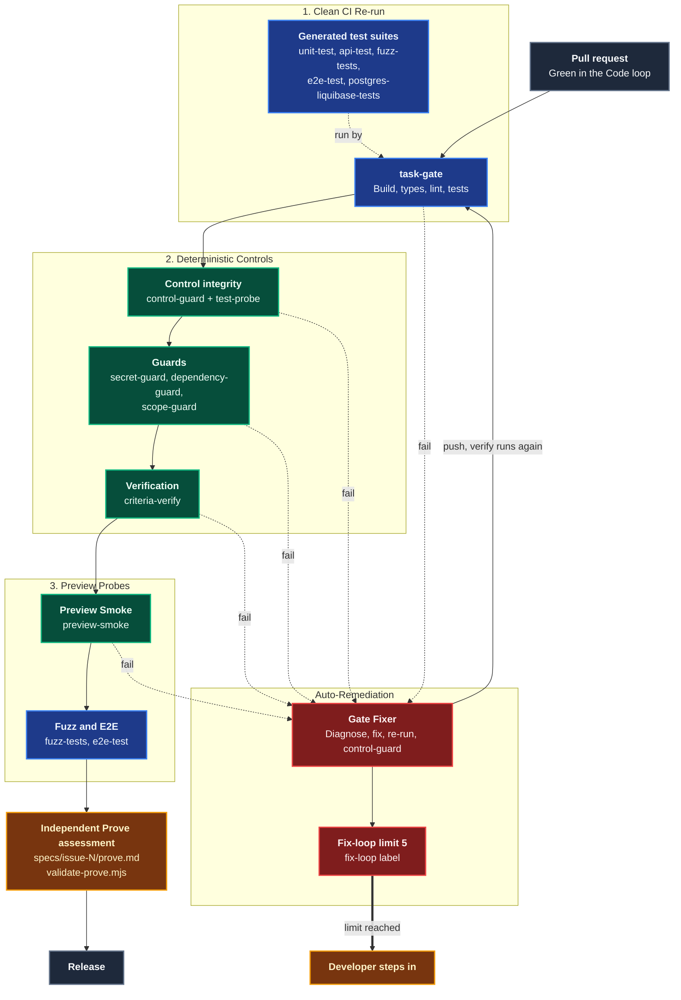
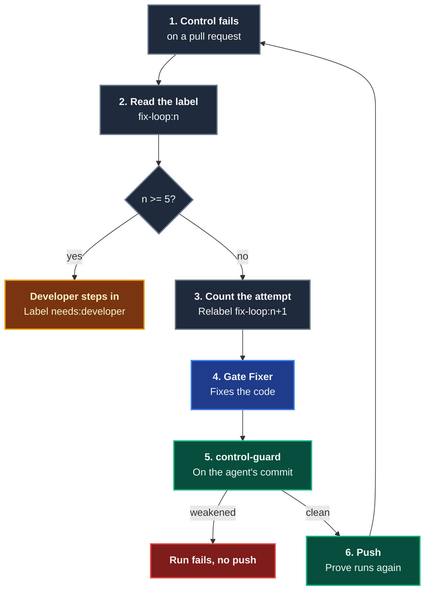

# Prove

The **Prove** domain is stage 5 of the [Agentic Software Factory](https://alten-group.github.io/agentic-software-factory/guide/stage-prove). It combines 8 deterministic controls and independent agent assessment of intent, behaviour, and safety in `specs/issue-<n>/prove.md`, without mandatory human sign-off.

Controls decide. Agents write tests, repair failures, and independently assess the implementation. All risk tiers can proceed automatically; High/Critical retain rollback evidence and Critical retains staged rollout requirements (see [Code](./domain-code.md)). People intervene on unresolved failures or exhausted retries. The same control scripts run locally and in CI.


## Domain Architecture



---

## The Controls and the Skills That Implement Them

The table follows the [Prove stage](https://alten-group.github.io/agentic-software-factory/guide/stage-prove) of the factory.

| Control | Type | Coding Pal skill / script | What it proves |
|---|---|---|---|
| **Clean CI Re-run** | Gate | `prove` (`task-gate.mjs`) | Build, type check, lint, and tests pass where the agent cannot influence the result |
| **Criteria Test Verification** | Gate | `prove` (`verify-criteria.mjs`, [details](#_1-criteria-test-verification)) | Every acceptance criterion has a passing test |
| **API Tests** | Contract | `api-test` agent and `node-express-examples` | Each endpoint returns the agreed statuses and bodies |
| **Fuzz Tests** | Probe | `fuzz-tests` agent and `restler-fuzzing-tests` | The API survives malformed input |
| **Database Tests** | Gate | `postgres-liquibase-examples` (`postgres-liquibase-tests` prompt) | Schema and migrations behave as specified |
| **E2E Tests** | Probe | `e2e-test` agent | The main journeys work on the running application |
| **Unit Tests** | Gate | `unit-test` agent | Generated code behaves as specified (run by the clean re-run) |
| **Secret & Dependency Guards** | Guard | `prove` (`secret-guard.mjs`, `dependency-guard.mjs`) | No leaked secrets or unapproved dependencies |
| **Control integrity** | Guard | `prove` (`control-guard.mjs`, [details](#_2-control-integrity-and-the-bug-rule)) | No control was weakened to get a pass |
| **The bug rule** | Guard | `prove` (`test-probe.mjs`, [details](#_2-control-integrity-and-the-bug-rule)) | The new check fails without the fix and passes with it |
| **Preview Smoke Tests** | Probe | `prove` (`preview-smoke.mjs`, [details](#_3-preview-smoke-tests)) | The application starts, routes traffic, and answers health checks |
| **File scope** | Guard | `prove` (`scope-guard.mjs`) | The change stays inside the Plan's file scope |
| **Prove Record** | Protocol | `prove` (`validate-prove.mjs`) | All 8 controls, criteria traceability, semantic review, findings, and verdict are recorded |

---

## Capabilities Matrix

| Capability | Invocation / Entry Point | Specialist Agent | Scoping Instruction | Supporting Skill | Output |
|---|---|---|---|---|---|
| **Criteria test verification** | `node .agents/skills/prove/scripts/verify-criteria.mjs` in the agent loop and CI | none (script) | [`prove`](./catalog-instructions.md) | [`prove`](./catalog-skills.md) | Markdown table: criterion, tests, verdict. Exit 0 only when every criterion passes |
| **Control integrity and bug rule** | CI, after every agent fix, or `control-guard.mjs` and `test-probe.mjs` | none (scripts) | [`prove`](./catalog-instructions.md) | [`prove`](./catalog-skills.md) | `RULE file:line message` findings, test falsifiability |
| **Preview smoke** | CI `preview` job, or `preview-smoke.mjs` | none (script) | [`prove`](./catalog-instructions.md) | [`prove`](./catalog-skills.md) | Per-route pass or fail |
| **Pull request Prove validation** | [`/prove`](./catalog-prompts.md) or [`Prove Validator`](./catalog-agents.md) in CI, then `validate-prove.mjs` | [`Prove Validator`](./catalog-agents.md) | [`prove`](./catalog-instructions.md) | [`prove`](./catalog-skills.md) | Validated `specs/issue-<n>/prove.md` with control table, criteria traceability, semantic review, findings, and `PASS\|FAIL` verdict |
| **Agent auto-remediation** | [`/fix-gates`](./catalog-prompts.md) or the [`Gate Fixer`](./catalog-agents.md) in CI | [`Gate Fixer`](./catalog-agents.md) | [`prove`](./catalog-instructions.md) | [`prove`](./catalog-skills.md) | A fix commit that passes the failed control, or a hand-over |

---

## Capability Workflows

### 1. Criteria Test Verification

- **When to Run**: After a Code step finishes its tests, to see which acceptance criteria are still open. Again in CI on the pull request, against the clean re-run's reports.
- **Why a Gate**: A green test run does not mean the *right* things were tested. The Plan record lists the criteria the Product Owner and Developer agreed. This gate proves each has a passing test.
- **Workflow Steps**:
  1. **Name**: The agent names each test after the criterion it verifies, for example `it("AC-2 rejects viewers", ...)`. The Test Plan table in `plan.md` already lists the test file per criterion.
  2. **Report**: The test runner writes JUnit XML, Jest/Vitest JSON, or TAP / runner log output.
  3. **Verify**:
     ```bash
     node .agents/skills/prove/scripts/verify-criteria.mjs \
       --plan specs/issue-42/plan.md \
       --report reports/jest.json --report reports/api-junit.xml --require-test-files
     ```
  4. **Read the table**: each criterion is `PASS`, `FAIL`, `NOT COVERED`, `NOT PASSING`, or `TEST FILE NOT REPORTED`, with the reason listed below the table. Tests that map to no criterion are listed as information.

#### What the Gate Enforces

| Check | Why |
|---|---|
| A test maps to a criterion only by a word-bounded `AC-<n>` token (case-insensitive) in its name, title, full name, or class name | Explicit and auditable: `AC-1` never matches `AC-12` |
| Every criterion needs at least one passing mapped test | The Plan record is the definition of done |
| One failed mapped test fails the criterion, even when a sibling passes | A failing assertion is never offset |
| Skipped and pending tests do not count | `it.skip` verifies nothing |
| `--require-test-files`: each Test Plan test file appears among the reported files | The planned test was actually run, not replaced by another |
| An empty or unrecognized report is an error | No report, no proof |
| Unknown arguments are errors | A mistyped flag cannot silently weaken the gate |

### 2. Control Integrity and the Bug Rule

- **When to Run**: After every agent change or fix, and in CI on the pull request diff.
- **Workflow Steps**:
  ```bash
  node .agents/skills/prove/scripts/control-guard.mjs --git origin/main
  ```
  Then prove the new check fails without the fix with `test-probe.mjs` from the [`prove`](./catalog-skills.md) skill.

#### What the Guard Enforces

| Rule | Fails when |
|---|---|
| R1 | A test file is deleted |
| R2 | A skip or only marker is added (`.skip(`, `xit(`, `.only(`, `@Disabled`, ...) |
| R3 | A threshold is lowered (`branches`, `minScore`, `fail_under`, `--min-score`, ...) |
| R4 | A workflow is weakened: `continue-on-error: true`, `\|\| true`, `--no-verify`, `if: false`, a deleted workflow or job |
| R5 | A protected path changes: installed skills, workflows, `control-guard.json`, `waivers.json` |
| R6 | A suppression is added (`eslint-disable`, `@ts-ignore`, `# noqa`, `biome-ignore`, `NOSONAR`) |
| R7 | An agent or remediation workflow exposes production credentials |
| R8 | A modified test file loses assertions |
| Bug rule | The new check does not fail when the modified production source is reverted (`test-probe`) |

#### The Bug Rule

Every production defect results in a new automated check that fails without the fix and passes with it. `test-probe` proves the check **fails without the fix** by temporarily reverting modified source files to the base branch and running the test command.

### 3. Preview Smoke Tests

- **When to Run**: In the CI `preview` job, after the stack is up and before fuzz and E2E tests.
- **Workflow**:
  ```bash
  node .agents/skills/prove/scripts/preview-smoke.mjs \
    --url http://localhost:3000 --routes preview-routes.json
  ```
- **Behavior**: It retries only while the app is not answering (connection errors, timeouts, unexpected 5xx), then evaluates each route's status, JSON field, and time limit once.

### 4. Agent Auto-Remediation

- **When to Run**: Automatically when a Prove control fails on a pull request, or interactively with `/fix-gates <gate output or PR number>`.
- **Workflow Steps**:
  1. **Read** the failing gate output.
  2. **Diagnose** the exact fault and reproduce it by re-running only that control.
  3. **Fix** the code within the Plan step's file scope.
  4. **Re-run** the failed control, then `control-guard`.
  5. **Count the attempt** against the 5-attempt fix-loop limit (for example in the `fix-loop:<n>` label on a pull request).
  6. **Commit and push.** CI runs verification again.
  7. **Stop at the limit.** After 5 attempts the Developer steps in.



- **Boundary**: The Gate Fixer can never weaken, skip, edit, or waive a control, and never touches protected paths. `control-guard` enforces this on its commit, using the copy of the control taken from the base branch before the agent runs.

### 5. Independent Automated Assessment (`prove.md`)

When the 8 deterministic controls (`control-guard`, `secret-guard`, `dependency-guard`, `scope-guard`, `task-gate`, `criteria-verify`, `test-probe`, `preview-smoke`) run, the [`Prove Validator`](./catalog-agents.md) assesses intent, behaviour, and safety against `think.md` and `plan.md`, recording the evidence and verdict in `specs/issue-<n>/prove.md` and validating it with `skills/prove/scripts/validate-prove.mjs`. Every tier permits automatic continuation; rollback and rollout evidence remain mandatory where required. Human review is an explicitly requested checkpoint or escalation, not routine sign-off.

- **Falsifiable Done When**:
  - All 8 deterministic controls pass (or `preview-smoke` is `SKIPPED` when no routes config exists) and `validate-prove.mjs` exits with code 0.
  - For a defect fix, `test-probe` shows the new check fails without the fix.
  - No control, waiver, workflow, or installed skill was changed by an agent, and no fix-loop exceeded 5 attempts.

---

## CI for Coding Pal Itself

Coding Pal tests its own skills with `.github/workflows/test-skills.yml`: on every push and pull request it sets up Node 22, runs `node --test skills/*/scripts/*.test.mjs`, and runs `context-lint` on the repository.

---

## Related Catalogs & Schemas

- [Prompts Catalog](./catalog-prompts.md)
- [Agents Catalog](./catalog-agents.md)
- [Instructions Catalog](./catalog-instructions.md)
- [Skills Catalog](./catalog-skills.md)
- [Deterministic Controls](./deterministic-controls.md)
- [Code Domain](./domain-code.md)
- [Testing Domain](./domain-testing.md)
- [Controls Domain](./domain-controls.md)
- [Think & Plan Domain](./domain-think-plan.md)
- [Persistent Context Architecture](./persistent-context.md)
