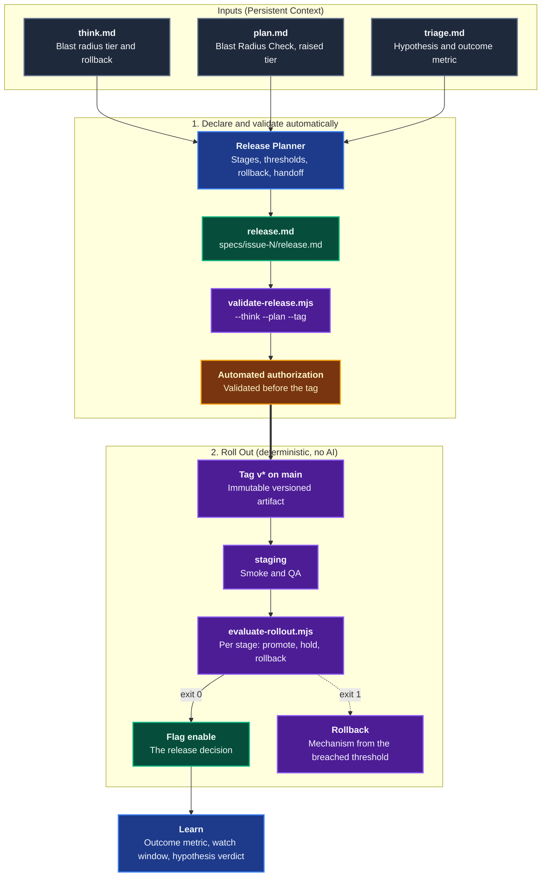
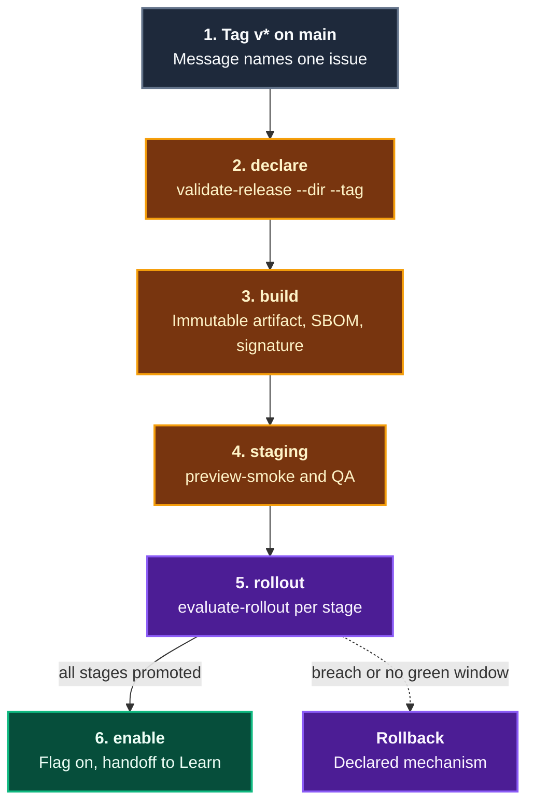

# Release

The **Release** domain declares how one change reaches users: an immutable versioned artifact, gradual rollout stages, thresholds that promote or roll back on their own, a named rollback, and the outcome metric handed to Learn. It is stage 6 of the [Agentic Software Factory](https://alten-group.github.io/agentic-software-factory/guide/stage-release), follows [Prove](./domain-prove.md), and feeds [Learn](./domain-learn.md).

Deploying and releasing are two different things. Deploying puts the code in production, switched off. Releasing is switching it on for users, a few at first, then everyone. The `enable` flag is the release decision.

AI prepares the declaration and release documentation. Deterministic validation authorizes release without mandatory human sign-off; DevOps remains accountable for the policy and exceptions. Standard deployment tooling executes the rollout, while `evaluate-rollout.mjs` computes promote, hold, and rollback decisions from declared thresholds.

---

## Domain Architecture



---

## Capabilities Matrix

| Capability | Invocation / Entry Point | Specialist Agent | Scoping Instruction | Supporting Skill | Output Artifact |
|---|---|---|---|---|---|
| **Release Declaration** | [`/release-plan`](./catalog-prompts.md) | [`Release Planner`](./catalog-agents.md) | [`release`](./catalog-instructions.md) | [`release-plan`](./catalog-skills.md) | `specs/issue-<n>/release.md` (stages, thresholds, rollback, outcome metric) |
| **Rollout Decision** | `evaluate-rollout.mjs` in the release pipeline (no agent) | None: deterministic | [`release`](./catalog-instructions.md) | [`release-plan`](./catalog-skills.md) | JSON decision and exit code per stage |
| **Release Pipeline** | `.github/workflows/release.yml` from the skill's `references/release.yml` | None: standard tooling | [`release`](./catalog-instructions.md) | [`release-plan`](./catalog-skills.md) | Signed artifact, rollout log, enabled flag or rollback |

---

## Capability Workflows

### 1. Release Declaration

- **When to Run**: For every change that passed Prove, before its tag is pushed. Interactively in the IDE (`/release-plan #42`) or headlessly in CI.
- **Why a Declaration**: "Watch the dashboard and decide" is not a gate. Thresholds, watch windows, and the rollback are fixed before deployment, so the rollout needs no judgement and no one can loosen a limit mid-flight.
- **Workflow Steps**:
  1. **Read**: The `Release Planner` reads `think.md` (tier, rollback), `plan.md` (any raised tier), and `triage.md` (hypothesis, outcome metric). It stops if Think or Plan is missing.
  2. **Declare**: It writes the single issue, the tier, the version, the immutable artifact reference, and the `enable` or `<feature>.enable` flag.
  3. **Stage**: It picks the rollout ladder for the effective tier after `staging` at 0%: Low `100%`; Medium canary `5%` then `100%`; High canary `5%`, one step above `5%` and at most `50%`, then `100%`; Critical `5%`, `25%`, `50%`, `100%`.
  4. **Threshold**: It proposes health thresholds (error rate, latency, saturation) and a business threshold when an outcome metric is named. Every row names its rollback mechanism.
  5. **Roll back**: It writes the rollback mechanisms and the primary one. For High and Critical, the primary includes Think's rollback text.
  6. **Hand off**: It copies the outcome metric, baseline, target, direction, watch window days, and hypothesis ledger row for Learn.
  7. **Validate**:
     ```bash
     node .agents/skills/release-plan/scripts/validate-release.mjs \
       --release specs/issue-42/release.md \
       --think specs/issue-42/think.md --plan specs/issue-42/plan.md
     ```
  8. **Authorize**: Validate thresholds against the recorded service baseline and record automated authorization before pushing the tag. Escalate unresolved validation failures, not routine approval.

#### The Declaration at a Glance

| Section | What it fixes |
|---|---|
| `## Release` | One issue, tier, version, artifact, flag, owner `DevOps`, customer commitment |
| `## Rollout Stages` | `Stage`, `Traffic`, `Watch Window`, `Promotion` (always `automatic on green window`) |
| `## Thresholds` | `Metric`, `Kind` (`health` or `business`), `Comparator`, `Limit`, `Rollback` |
| `## Rollback` | Mechanisms with how, `Primary`, `Decided By`, optional `Data-Affecting` |
| `## Outcome Metric` | The handoff to Learn |
| `## Changelog` | One customer-facing line when a customer commitment exists |
| `## Ambiguities & Open Questions` | What DevOps must settle |

#### Rollout Shape by Tier

The production ladder rises with the blast radius, always after `staging`. The shape is exact: fewer stages, extra stages, or another shape are rejected. The effective tier decides it, so a tier raised in Plan brings the raised ladder.

| Tier | Production stages | Required shape |
|---|---|---|
| Low | 1 | 100% |
| Medium | 2 | Canary 5%, then 100% |
| High | 3 | Canary 5%, exactly one intermediate step above 5% and at most 50%, then 100% |
| Critical | 4 | 5%, 25%, 50%, 100% (the factory ladder) |

For a Critical change every production stage's watch window must be at least as long as the previous one.

#### Rollback Mechanisms

| Mechanism | Time to effect | Used for |
|---|---|---|
| `Feature flag off` | Seconds | Behavior regressions |
| `Traffic shift back` | Under 1 minute | Deployment-level failures |
| `Redeploy previous artifact` | Minutes | Config or runtime issues |
| `Forward fix` | Hours | Data-affecting issues where rollback is unsafe (needs `Data-Affecting: yes`, never automatic) |

#### What the Validator Enforces

| Check | Why |
|---|---|
| Exact section order and headings, no code blocks | Predictable for DevOps and the pipeline |
| `Issue` is one or more `#<n>` references | Tracks the change; avoids unrelated batching that muddies blast radius |
| `Artifact` carries the version or a digest, never `latest`, no credentials | Immutable, reproducible, rollback to a known version |
| `Version` matches the tag (`--tag`) and appears in the artifact | One name for one release |
| `Flag` is `enable` or `<feature>.enable` | The flag is the release decision |
| `Owner` is `DevOps` | One accountable owner |
| `staging` first at 0%, strictly increasing, ends at 100% | Gradual exposure, reversible at every step |
| The exact production ladder for the effective tier (1, 2, 3, or 4 stages, Critical is 5%, 25%, 50%, 100%) and non-shrinking Critical windows | Exposure grows with the blast radius |
| Promotion is `automatic on green window`, windows are positive durations | No judgement call in the moment |
| Health thresholds for error rate, latency, saturation, matched on whole metric-name words | The rollout always watches the basics |
| Those health thresholds use `<` or `<=` with a limit above 0 (at most 100 for percentages), and no rate or percentage threshold is vacuous | A threshold that can never fail, or always fails, is no gate |
| An inverse metric such as `error_free_rate` is `business`, never `health` | Higher-is-better metrics cannot stand in for a health limit |
| A business threshold when an outcome metric is named | The change is measured on its purpose |
| Every threshold names an automatic rollback listed in `## Rollback` | A rollback exists for every breach |
| `Forward fix` only with `Data-Affecting: yes` | Rollback is the default, forward fix the exception |
| `--think`: tier equals Think's, High/Critical has a rollback and `Primary` contains it | A change with no rollback path is not deployed |
| `--plan`: tier equals Plan's, honouring `Raised to <tier>` | The tier set once is the tier released |
| Outcome Metric: numeric baseline and target in the stated direction, ledger `<path>#<row>` | A real handoff to Learn |
| Changelog line when `Customer Commitment` is `yes`, `_None._` otherwise | Release notes match the commitment |

### 2. Rollout Decision

- **When to Run**: Between stages in the release pipeline, and on every poll inside a watch window.
- **Workflow**: The pipeline collects `metrics.json` from the observability backend and asks the script.
  ```bash
  node .agents/skills/release-plan/scripts/evaluate-rollout.mjs \
    --release specs/issue-42/release.md --stage canary-5 --metrics metrics.json
  ```
  `metrics.json` is `{ "stage": "canary-5", "observedMinutes": 30, "metrics": { "error_rate": 0.4, "latency_p95_ms": 220 } }`. `stage` is required and must match `--stage`, and each metric carries its worst value over the observed window. The output is `{ "decision", "stage", "reasons", "rollbackWith" }`.

| Order | Condition | Decision | Exit code |
|---|---|---|---|
| 1 | Any threshold breached, even before the window ends | `rollback` with the threshold's mechanism | 1 |
| 2 | A threshold metric is missing or not a number | `hold` | 2 |
| 3 | The watch window is not fully observed | `hold` | 2 |
| 4 | Every threshold inside its limit for the whole window | `promote` | 0 |

- **Staging**: `staging` reads `smoke_failures` and `qa_failures` instead of the production thresholds. A value above 0 stops the release with nothing exposed to users.
- **Several breaches**: `rollbackWith` is the broadest mechanism among them (`Redeploy previous artifact`, then `Traffic shift back`, then `Feature flag off`).
- **Errors**: an unknown stage, a `metrics.json` that names no stage or another stage, a malformed file, an unknown flag, or an invalid `release.md` also exits 1. A pipeline treats anything other than 0 or 2 as a rollback.
- **Boundary**: the same release and metrics always give the same decision. There is no override flag, and no AI.

### 3. Release Pipeline



1. **One issue per tag**: the pipeline rejects a tag message that names zero or several issues, and a tag that is not on `main`.
2. **Immutable artifact**: the build refuses to overwrite an existing version. Build, SBOM, and signing steps are `PLACEHOLDER`s for your toolchain.
3. **Smoke before users**: staging runs `preview-smoke` and the QA suite, then the staging gate.
4. **Exit codes drive the loop**: `0` promotes to the next stage, `2` keeps polling (and rolls back after `MAX_HOLD_POLLS`), `1` records the mechanism and the `rollback` job applies it.
5. **No long-lived production secrets**: jobs get short-lived OIDC tokens through the `production` environment. No agent runs in the workflow, and none holds production credentials.
6. **Placeholders are explicit**: traffic shifting, metric collection, flag changes, and rollback commands are marked `PLACEHOLDER` in the template.

- **Falsifiable Done When**:
  - `release.md` passes `skills/release-plan/scripts/validate-release.mjs` with exit code 0, cross-checked against `think.md` and `plan.md`.
  - One issue, an immutable versioned artifact, a threshold with a named rollback for each health metric, and an outcome metric (or a stated reason for none) are declared.
  - Every rollout stage decision came from `evaluate-rollout.mjs`, and a rollback used the mechanism the breached threshold named.
  - The rollout reached 100% with every watch window green, and the change's observability dashboard is live in Learn (the factory's exit gate; the template marks the check `PLACEHOLDER`).
  - Deployment and flag changes run through deterministic tooling, agents hold no direct production credentials, and automated release authorization is recorded before the tag.

---

## Related Catalogs & Schemas

- [Prompts Catalog](./catalog-prompts.md)
- [Agents Catalog](./catalog-agents.md)
- [Instructions Catalog](./catalog-instructions.md)
- [Skills Catalog](./catalog-skills.md)
- [Persistent Context Architecture](./persistent-context.md)
- [Think & Plan Domain](./domain-think-plan.md)
- [Triage Domain](./domain-triage.md)
- [Prove Domain](./domain-prove.md)
- [Learn Domain](./domain-learn.md)
- [Code Domain](./domain-code.md)
