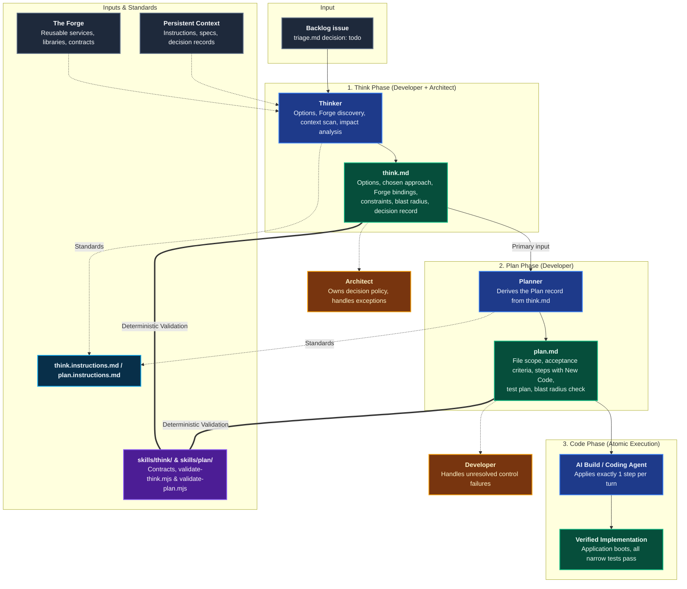
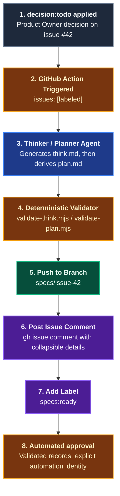

# Think & Plan

The **Think & Plan** domain provides an agentic specification methodology that turns a prioritized backlog issue into persistent, machine-consumable records: `think.md` (the **Think record**) and `plan.md` (the **Plan record**). It implements stages [2 — Think](https://alten-group.github.io/agentic-software-factory/guide/stage-think) and [3 — Plan](https://alten-group.github.io/agentic-software-factory/guide/stage-plan) of the Agentic Software Factory and follows the [Triage](./domain-triage.md) stage.

Rather than narrative PRDs, Coding Pal enforces two stages: **Think** chooses and records an approach, Forge bindings, constraints, and blast radius; **Plan** defines file scope, criteria, atomic steps, and tests. AI decides and approves autonomously at every risk tier, including API, schema, High, and Critical changes. Required controls, rollback evidence, and retry limits remain enforced. People intervene on unresolved failures or requested checkpoints.

---

## Domain Architecture



---

## Capabilities Matrix

| Capability | Invocation / Entry Point | Specialist Agent | Scoping Instruction | Supporting Skill | Output Artifact |
|---|---|---|---|---|---|
| **Business Needs to Specifications** | Planning session or [`Thinker` & `Planner`](./catalog-agents.md#_10-thinker-think-agent-md-planner-plan-agent-md) agents (CI) | [`Thinker` & `Planner`](./catalog-agents.md#_10-thinker-think-agent-md-planner-plan-agent-md) | [`think` & `plan`](./catalog-instructions.md#think-plan-instructions) | [`think` & `plan`](./catalog-skills.md#_10-think-skills-think-plan-skills-plan) | `specs/issue-<n>/think.md` and `plan.md` (options, Forge bindings, blast radius, acceptance criteria, atomic steps with code) |

---

## The Two Records

| | `think.md` (Think record) | `plan.md` (Plan record) |
|---|---|---|
| **Owner** | Developer + Architect | Architect + Developer |
| **Decides** | The approach | The sequence |
| **Contains** | Options considered, chosen approach, Forge asset bindings, system flow, constraints and invariants, blast radius, decision record, Persistent Context updates, open questions | File scope and boundaries, prerequisites, acceptance criteria, implementation checklist, test plan, open questions and assumptions, blast radius check |
| **Code** | None | Only inside each step's `New Code` field |
| **Reads** | The backlog issue and `triage.md`, the Forge, Persistent Context, the codebase | The validated `think.md` |
| **Approved by** | Explicit automation identity and date in `## Chosen Approach` | Explicit automation identity and date in `## Approval` |

The Plan reads Think's bindings, constraints, and tier. After validation, both records use `Approved By: Automated by <identity> on YYYY-MM-DD`, with Plan dated no earlier than Think. Human approval remains supported for requested checkpoints; automation must never forge a human signature.

---

## Capability Workflows

### 1. Business Needs to Specifications: Think & Plan

- **When to Run**: For every backlog issue the Product Owner decides as `todo`. Interactively in the IDE (planning session) or headlessly in CI when the `decision:todo` label is applied (or on `issues: [opened]` where Triage is not used).
- **Why It Replaces Traditional Specs**:
  - Traditional PRDs and narrative design docs are verbose, full of unstated assumptions, and swamp the LLM context window with conversational prose.
  - In an agentic operating model, specifications are actionable data structures for models:
    1. `think.md` records the options weighed, the approach chosen, the reusable assets composed, and the blast radius, so the decision is reviewable before anything is planned.
    2. `plan.md` sequences the implementation into atomic, dependency-ordered steps. Each step carries its code, a narrow verification, and a bootable check, and traces to the acceptance criteria it serves.
  - Downstream build agents consume `plan.md` one step at a time in fresh context sessions, preventing error compounding.
- **Workflow Steps**:
  1. **Phase 1: Think**:
     - *Interactive (IDE)*: Open a planning session: *"Think through issue #42 and save the Think record to specs/issue-42/think.md."*
     - *Headless (GitHub Action)*: Triggered by the Product Owner's `decision:todo` label, invoking the **Thinker** agent (`think.agent.md`). Where Triage is not used, trigger on `issues: [opened]` with the issue title and body.
     - The agent validates `triage.md` at the `final` stage and proceeds only on `todo`, reusing the Triage evidence and system mapping.
     - It scans the codebase, Forge, and Persistent Context, weighs 2 to 4 options, selects one, binds assets, and classifies blast radius. Required decisions are accepted with an Automation decider and `Automated by <identity> on YYYY-MM-DD` attribution after validation.
  2. **Phase 2: Plan**:
     - *Interactive (IDE)*: In a clean session: *"From specs/issue-42/think.md, generate specs/issue-42/plan.md."*
     - *Headless (CI)*: The **Planner** agent (`plan.agent.md`) synthesizes `plan.md` from the validated `think.md`.
     - Emits the file scope, acceptance criteria, steps with `Files`, `Action`, `New Code`, `Verification`, `Bootable Check`, and `Serves`, the test plan, and the blast radius check.
  3. **Phase 3: Automated Validation**:
     ```bash
     node .agents/skills/think/scripts/validate-think.mjs --think specs/issue-42/think.md
     node .agents/skills/plan/scripts/validate-plan.mjs --dir specs/issue-42
     ```
     This checks the drafts (`--stage draft`, the default). After the named approvals are recorded, `--stage approved` checks them.
  4. **Phase 4: Agentic Coding**:
     - After validation, record automated approval in `## Approval` and launch the [`Code Agent`](./domain-code.md) with clean context (`/code 42`). Human review is an optional requested checkpoint.
     - It implements one step per turn through `code-loop`, applying the step's `New Code`, adjusting only as needed to fit the real repository, and keeps the application bootable.

#### What the Validator Enforces

| Check | Why |
|---|---|
| Exact section order and headings in both records | Predictable structure for reviewers and agents |
| 2 to 4 sequential options, each with source, trade-offs, cost, and risk | Think records a decision, not a conclusion |
| Forge bindings are `forge/<id>@<version>` and match the selected option; a custom build needs a recorded reason | Compose before you build |
| Blast radius tier set; rollback named for High and Critical (also when Plan raises the tier) | The tier drives automated validation and rollback evidence in Prove |
| No source code, checklist, or step headings in `think.md` | Code lives in the Plan's `New Code` fields only |
| Critical requires a decision record; autonomous records use an Automation decider and valid automation attribution | Human signatures remain reserved for actual humans |
| `Approved By` accepts `Automated by <identity> on YYYY-MM-DD` at draft and approved stages; actual human approvals remain supported | Automated Plan approval must not precede Think approval; Pending is incomplete, not approval |
| Prerequisites & Context holds the `think.md` reference plus at least one more line (dependencies, environment variables, services, or `- None.`) | A bare reference leaves Step 1's setup unstated |
| 3 to 8 sequential `Given ..., then ...` acceptance criteria | Observable, testable statements |
| Step fields in order, including `New Code` as a fenced block or `_None._`, `Verification` and `Bootable Check` as commands in backticks, and `Serves` | Code is reviewable per step, checked by a command, and traceable to criteria |
| Every in-scope file covered by a step; no step outside scope | File scope is the boundary |
| Every criterion served by a step and present in the test plan, with a serving step | Criteria are provable |
| Irreversible changes have a reverse step; migration-looking paths cannot claim none | A revert must be able to undo the change |
| Questions answered before Code (`--allow-open-questions` for drafts) | No open questions reach Code |
| Blast radius check matches Think, raised tiers are higher and explained | The tier holds for the file scope |
| Cross-check: every Think Persistent Context update has a plan step | Context changes are planned like any other work |
| Code fences are opaque | Code cannot break headings or fields |

#### Downstream Execution Discipline

When an AI build agent implements functionality from `plan.md`:
1. It reads `plan.md` in a fresh chat session (clean context).
2. It executes **exactly one step** from the checklist, applying the step's `New Code`.
3. It runs the step's `Verification` command and asserts that the application still boots (`Bootable Check`).
4. Only when both pass does it mark the step done and proceed to the next step in a clean session.

The plan's In Scope list can also feed the [`scope-guard`](./catalog-skills.md#_11-scope-guard-skills-scope-guard) skill, and the `AC-n` identifiers give Prove a stable handle for criteria-test verification.

#### Storage & GitHub Issue Attachment Pattern

When automating specifications from GitHub issues in CI/CD, specifications follow the **Issue Comment + Dedicated Branch** pattern:



1. **Non-destructive Issue Comment**: The action **never overwrites** the issue description. Leaving the human words intact preserves the authentic requirement while keeping discussions and reviews threaded.
2. **Collapsible Visual Layout**: Full specifications are posted in a comment formatted with HTML `<details>` tags:
   - `think.md` enclosed in `<details><summary>🧠 <b>think.md (Options, Blast Radius &amp; Constraints)</b></summary> ... </details>`.
   - `plan.md` enclosed in `<details open><summary>📝 <b>plan.md (Scope, Criteria &amp; Steps)</b></summary> ... </details>`.
3. **Dedicated Branch Storage**: Files are committed to `specs/issue-<number>/` on branch `specs/issue-<number>`, next to `triage.md`.

- **Falsifiable Done When**:
  - `think.md` passes `skills/think/scripts/validate-think.mjs` and `plan.md` passes `skills/plan/scripts/validate-plan.mjs` with exit code 0, including the cross-check.
  - Required decisions pass validation and record explicit automation attribution without fabricated human signatures.
  - Both `Approved By` fields record the automation identity and date; `--stage approved` passes before automatic continuation.
  - Zero production or test files were modified during specification generation.

---

## Related Catalogs & Schemas

- [Prompts Catalog](./catalog-prompts.md)
- [Agents Catalog](./catalog-agents.md)
- [Instructions Catalog](./catalog-instructions.md)
- [Skills Catalog](./catalog-skills.md)
- [Persistent Context Architecture](./persistent-context.md)
- [Triage Domain](./domain-triage.md)
- [Forge Domain](./domain-forge.md)
- [Governance & Decisions](./domain-governance.md)
- [Code Domain](./domain-code.md)
- [Specs & Docs Domain](./domain-docs.md)
