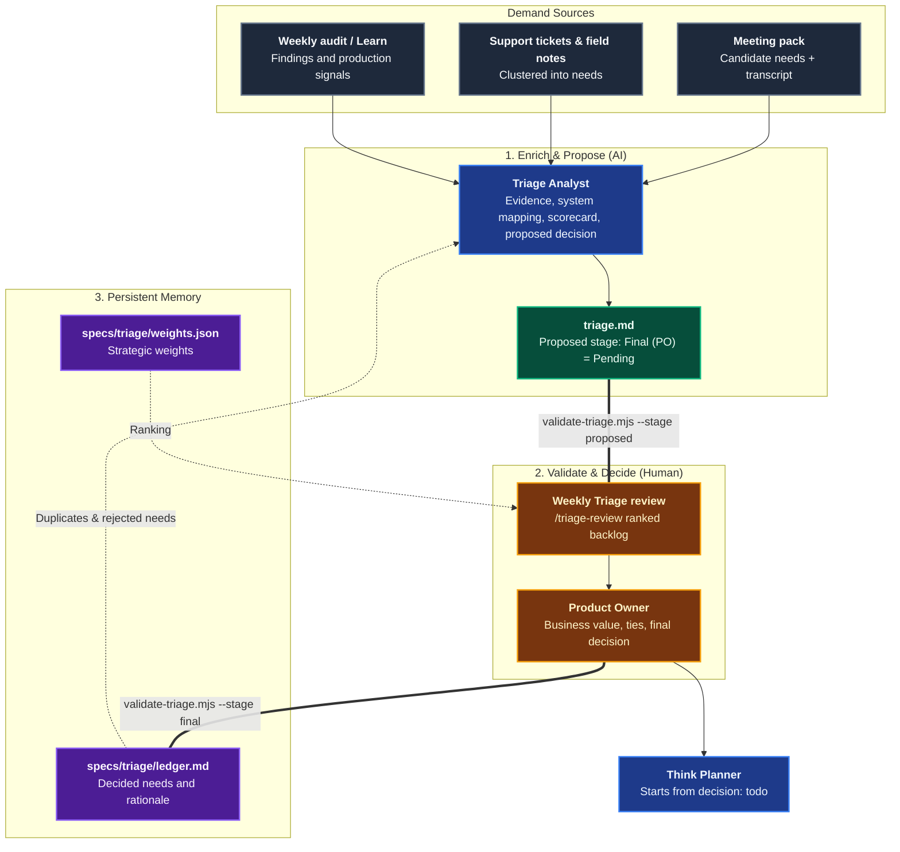
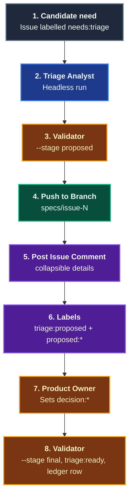

# Triage

The **Triage** domain turns candidate business needs into evidence-linked backlog issues with a prefilled scorecard and a proposed decision, as persistent, machine-consumable `triage.md` artifacts. It is stage 1 of the [Agentic Software Factory](https://alten-group.github.io/agentic-software-factory/guide/stage-triage), follows the [Meet](./domain-meet.md) domain, and feeds the [Think & Plan](./domain-think-plan.md) domain.

AI enriches, scores, and proposes. **The Product Owner decides.** Coding Pal enforces that split mechanically: an AI-produced `triage.md` can never carry a final decision, and a final one is only valid once a human has set it.

---

## Domain Architecture



---

## Capabilities Matrix

| Capability | Invocation / Entry Point | Specialist Agent | Scoping Instruction | Supporting Skill | Output Artifact |
|---|---|---|---|---|---|
| **Candidate Need to Backlog Issue** | [`/triage`](./catalog-prompts.md#_9-triage) or the [`Triage Analyst`](./catalog-agents.md#_11-triage-analyst-triage-agent-md) in CI | [`Triage Analyst`](./catalog-agents.md#_11-triage-analyst-triage-agent-md) | [`triage`](./catalog-instructions.md#triage-instructions) | [`triage`](./catalog-skills.md#_18-triage-skills-triage) | `specs/issue-<n>/triage.md` (evidence, system mapping, scorecard, proposed decision) |
| **Weekly Review Pack** | [`/triage-review`](./catalog-prompts.md#_10-triage-review) | [`Triage Analyst`](./catalog-agents.md#_11-triage-analyst-triage-agent-md) (review mode) | [`triage`](./catalog-instructions.md#triage-instructions) | [`triage`](./catalog-skills.md#_18-triage-skills-triage) | Ranked backlog, unscored needs, ties, and `explore` follow-ups (no files written) |

---

## Capability Workflows

### 1. Candidate Need to Backlog Issue

- **When to Run**: For every candidate need from a [Meeting Pack](./domain-meet.md) (arriving as an issue with a `meeting-candidate` marker), a support-ticket or field-note batch, the weekly audit, or a Learn signal. Interactively in the IDE (`/triage #42`) or headlessly in CI on an issue labelled `needs:triage`.
- **Why a Contract**: A narrative summary hides how thin the evidence is. A fixed structure shows the quote, its source, the score, and the proposed decision at a glance, and a validator can reject what a model cannot be trusted to self-police.
- **Workflow Steps**:
  1. **Gather**: The `Triage Analyst` resolves the need and its source material. A batch of tickets is clustered first, and each cluster is triaged as its own need.
  2. **Ground**: It reads Persistent Context (glossary, `docs/specs/`, decision records) and `specs/triage/ledger.md`. A need that was decided before is linked, not re-litigated.
  3. **Enrich**: It maps the need to existing capabilities and boundaries, names affected systems and early risk, and lists unknowns. It sets no blast radius tier: [Think](./domain-think-plan.md) does.
  4. **Score & Propose**: It fills the 1 to 5 scorecard, leaves Business value as `Pending PO`, and proposes `todo`, `explore`, `later`, or `no` with a rationale.
  5. **Validate**:
     ```bash
     node .agents/skills/triage/scripts/validate-triage.mjs \
       --triage specs/issue-42/triage.md --stage proposed \
       --source meetings/2026-09-24-acme-discovery/transcript.md --ledger specs/triage/ledger.md
     ```
  6. **Decide**: The Product Owner sets Business value and the final decision at the weekly review. CI validates the file at the `final` stage and appends the ledger row.
  7. **Hand off**: Think starts only from `todo`, and reuses the triage evidence and system mapping.

#### What the Validator Enforces

| Check | Why |
|---|---|
| Exact section order and headings | Predictable for the Product Owner and downstream agents |
| At least one non-anecdotal evidence row | Exit gate: no backlog issue on a single anecdote |
| `--source`: quotes found verbatim | Blocks fabricated or paraphrased client words |
| Integer 1 to 5 scores, `Low`/`Medium`/`High` confidence | Deliberately coarse: precision here is false precision |
| Customer value 4+ with Low confidence must propose `explore` | The factory's rule for uncertain, valuable needs |
| `Final (PO)` must be `Pending` and Business value must be `Pending PO` at the `proposed` stage | AI never decides which client problem matters most, nor scores the Product Owner's value |
| `final` stage: Business value scored, decision set, a named Product Owner in `Decided By`, overrides explained | Exit gate and institutional memory |
| `final` stage: Customer value 4+ with Low confidence answered `todo` needs an `Override Rationale` | Low-confidence, high-value needs get `explore`; overriding that leaves a recorded reason |
| No blast radius tier | That belongs to Think |
| `--ledger`: exact or `no`-similar duplicates need `Reopens` | Rejected needs build memory and are not re-litigated by accident |

#### Persistent Memory: Ledger and Weights

- **`specs/triage/ledger.md`** records every decided need (issue, title, decision, date, rationale). The agent reads it. CI or the Product Owner writes it after the final decision.
- **`specs/triage/weights.json`** holds the strategic weights the Product Owner owns. Changing it is a pull request, reviewed like any other Persistent Context.

#### Storage & GitHub Issue Attachment Pattern



1. **Non-destructive Issue Comment**: The human-written issue body is never overwritten.
2. **Collapsible Layout**: `triage.md` is posted inside `<details open><summary>🎯 <b>triage.md (Evidence, Scorecard &amp; Proposed Decision)</b></summary> ... </details>`.
3. **Dedicated Branch Storage**: Files live in `specs/issue-<number>/` on branch `specs/issue-<number>`, next to the later `think.md` and `plan.md`.
4. **Human Gate in Labels**: Only a person applies `decision:*`. Think triggers on `decision:todo`, not on issue creation.

### 2. Weekly Review Pack

- **When to Run**: Before the weekly Triage review.
- **Workflow**: `/triage-review specs` runs `rank-backlog.mjs`, which scores each valid `triage.md` as `(customerValue*C + businessValue*B) / (effort*E + risk*R) * confidence`, using the weights file. It lists needs awaiting a Business value score, ties for the Product Owner to break, parked `later`/`no` needs, and any invalid file it excluded.
  ```bash
  node .agents/skills/triage/scripts/rank-backlog.mjs --dir specs --weights specs/triage/weights.json
  ```
- **Boundary**: It ranks and reports. It decides nothing.

- **Falsifiable Done When**:
  - `triage.md` passes `skills/triage/scripts/validate-triage.mjs --stage proposed` with exit code 0.
  - No quote is unverified, no final decision was set by AI, and no blast radius tier is assigned.
  - Zero code was modified during triage.

---

## Related Catalogs & Schemas

- [Prompts Catalog](./catalog-prompts.md)
- [Agents Catalog](./catalog-agents.md)
- [Instructions Catalog](./catalog-instructions.md)
- [Skills Catalog](./catalog-skills.md)
- [Persistent Context Architecture](./persistent-context.md)
- [Think & Plan Domain](./domain-think-plan.md)
- [Meet Domain](./domain-meet.md)
- [Specs & Docs Domain](./domain-docs.md)
