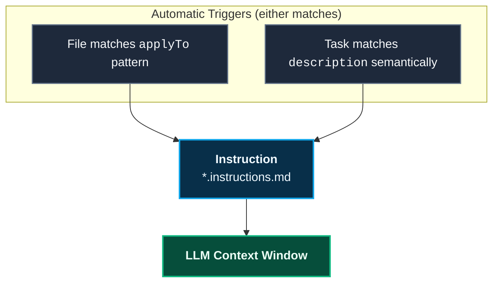
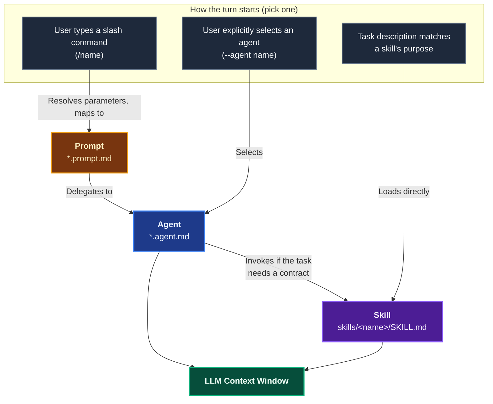
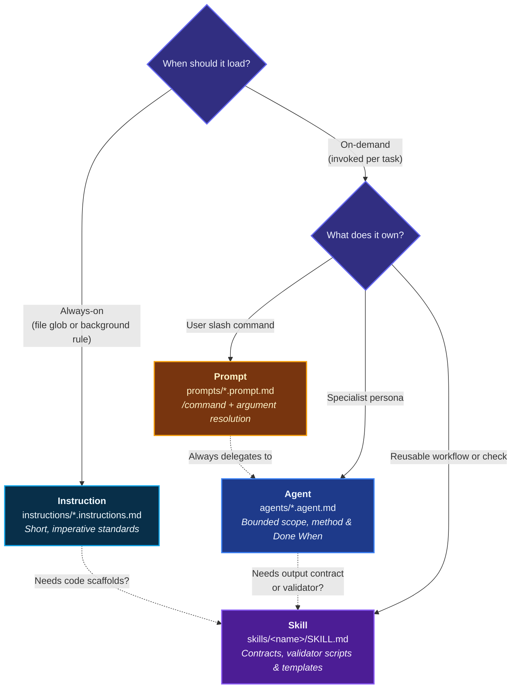
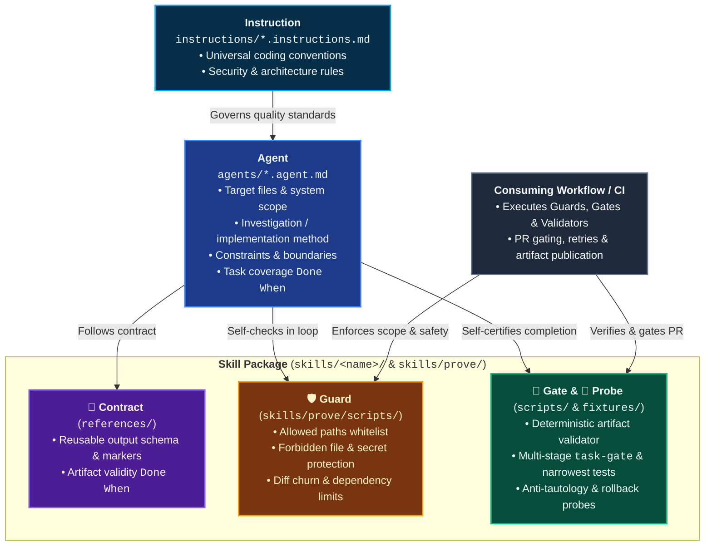
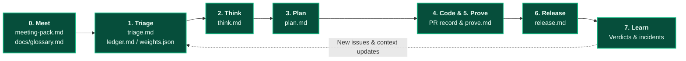

# Persistent Context Architecture

Persistent Context represents the collection of rules, schemas, specialized personas, and procedural workflows that remain available to an AI coding assistant across development cycles.

Instead of relying on volatile chat memory or giant prompt dumps, Coding Pal organizes persistent context into four distinct primitives, loaded dynamically according to context and user action.

## Context Lifecycle: Always-On vs On-Demand

Two rules govern how primitives reach the context window:

1. **An instruction file has two independent activation gates, and either one is enough to load it.** `applyTo` matches against a file the agent is working on this turn; `description` matches semantically against the task itself, with no file required at all. Neither gate needs a prompt, agent, or skill to request it — the check runs automatically in the background. If an instruction has neither an `applyTo` match this turn nor a `description` relevant to the task, it does not load. Where a match does happen (either gate), that instruction simply stacks underneath whichever prompt, agent, or skill also fires — it is never an alternative to them.
2. **Prompts, Agents, and Skills are three separate on-demand entry points.** Only one of them starts a given turn (a slash command, an explicit agent invocation, or a semantic skill match) — but a prompt or an agent can pull in a skill downstream of that entry point.

### The Always-On Layer

### The Three On-Demand Entry Points

Each entry point below is a separate way a turn can **start**. Pick the row that matches how the user acted; the instruction layer above still applies on top of all three.

Three things to read off this diagram:
- A **prompt** never reaches the context window directly — it always hands off to the agent it maps to.
- An **agent** (whether reached via a prompt or invoked directly) may pull in a **skill** if the task requires a reusable contract or validator.
- A **skill** can also be loaded directly, without selecting an agent. The assistant uses the skill's name and `description` in its `SKILL.md` frontmatter as a summary; when the user's request is a semantic fit for that description, the assistant can load the full skill instructions. This is not just keyword matching. For example, a request to run linting, type checks, and tests may match a skill whose description covers multi-stage verification.

| Primitive | Loading Model | Trigger Condition | Primary Purpose |
|---|---|---|---|
| **Instruction** | **Always-on** | Active file matches `applyTo` glob pattern | Stable rules, conventions, security guidelines, and architectural standards |
| **Agent** | **On-demand** | Explicitly selected (e.g. `--agent <name>`) | Scoped specialist with bounded method, strict constraints, and completion criteria |
| **Skill** | **On-demand** | The task semantically matches the skill's declared name/description, or an agent/user explicitly loads it | Multi-file procedures, contracts, executable validation scripts, and templates |
| **Prompt** | **On-demand** | Explicitly invoked via slash command (`/<name>`) | Parameterized entry point mapping user intent to agents and instructions |

## The Decision Tree

When adding persistent guidance, branch first by **when it should load**, then by **what it owns**. Solid arrows select the primary primitive; dashed arrows show when to pair it rather than overloading one file:

> [!TIP]
> If a single capability seems to span multiple answers, **split responsibilities**. Do not create a single file that attempts to act as an agent, define general coding standards, and dictate machine-readable report contracts all at once.

## Ownership Rules

A core tenet of Coding Pal is **Single Authoritative Ownership**:
- Every rule or convention belongs to exactly one file.
- Other primitives link to or invoke the owner; they do not restate, duplicate, or override the owner.

### 1. Instructions Own Standards
Durable, file-oriented standards live in `instructions/*.instructions.md`.
- Enforces conventions like error handling, SQL patterns, Docker container layering, or UI component structure.
- Injected automatically only when relevant files are in context via `applyTo`.
- Keeps instructions short and imperative. Scaffolding templates and long code samples belong in a paired skill under `skills/<name>-examples/`.

### 2. Agents Own Task Scope and Method
Specialist personas live in `agents/*.agent.md`.
- Answers: What work is in scope? Which layers are touched? What constraints apply? How is the task verified?
- Agents conduct work; they do not own report formats, schemas, or universal coding rules.

### 3. Skills Own Workflows, Contracts, and Validation
Complex, multi-step procedures live in `skills/<skill-name>/`.
- Always a directory containing `SKILL.md` plus optional `references/`, `scripts/`, `fixtures/`, and `templates/`.
- Owns machine-readable contracts and deterministic validation scripts.

### 4. Prompts Own Single Parameterized Operations
Slash commands live in `prompts/*.prompt.md`.
- Maps user inputs, selections, and active paths to a specific agent and its guiding instructions.
- Parameter resolution pipeline with clear precedence.

---

## The Golden Split

When an agent executes a workflow that produces a structured artifact or code change (e.g., Code Audit producing an audit report, Audit Fix repairing a finding, or Spec from Code producing technical specifications), responsibilities are split strictly across canonical primitives and the deterministic control roles they own:

| Concern | Authoritative Owner | Example in Coding Pal |
|---|---|---|
| Target files and systems to examine | **Agent** | `spec-from-code.agent.md` defines which modules are in scope |
| Method of investigation or repair | **Agent** | `gate-fix.agent.md` defines bounded gate failure repair |
| Domain coding standards & security rules | **Instruction** | `node-express.instructions.md`, `docker.instructions.md` |
| Task coverage completion | **Agent** (`Done When`) | "Every file in scope has been examined" |
| Reusable output schema and format | **Skill — Contract** (`references/`) | `skills/spec-from-code/references/spec-contract.md` |
| Artifact validity completion | **Skill — Contract** (`Done When`) | "Specification files satisfy the validation contract" |
| Blast-radius, secret & dependency boundaries | **Skill — Guard** (`skills/prove/scripts/`) | `scope-guard.mjs`, `secret-guard.mjs`, `dependency-guard.mjs` |
| Deterministic artifact validation | **Skill — Gate** (`scripts/`) | `skills/spec-from-code/scripts/spec-docs.mjs` |
| Falsifiable execution certification & probes | **Skill — Gate & Probe** (`scripts/`) | `task-gate.mjs`, `test-probe.mjs`, `validate-think.mjs`, `validate-plan.mjs` |
| CI publication, gating, and PR checks | **Consuming Workflow** | GitHub Actions workflow in consumer repo |

> [!IMPORTANT]
> An agent must say *"Follow the installed `spec-from-code` skill"*. It must **not** duplicate report headings, field names, or validation rules in its own body. Model compliance alone is not enforcement — workflows must run the deterministic skill script.

---

## Stage Records as Persistent Context

While **Instructions**, **Agents**, **Skills**, and **Prompts** define *how* an assistant operates, agents also need durable project memory across turns and lifecycle stages. Relying on narrative prose documents or volatile chat history introduces three failure modes:
1. **Context Window Exhaustion**: Long descriptive threads deplete the agent's context window before execution begins.
2. **Ambiguity & Hallucinated Scope**: Models infer unstated requirements or refactor adjacent components when boundaries are not explicit.
3. **Cross-Session State Loss**: Handing work from one specialist agent to the next (or resuming in a clean session) loses reasoning and constraints unless state is committed to the repository.

Across the [Agentic Software Factory](./overview.md#agentic-software-factory-coverage), every stage reads validated artifacts committed by upstream stages and writes its own machine-validated record:

| Stage | Persistent Record(s) | Authoritative Skill | Role in Context Continuity | Domain Guide |
|---|---|---|---|---|
| **0 — Meet** | `meeting-pack.md`, `docs/glossary.md` | `skills/meeting-pack/` | Captures verbatim client quotes and updates the shared domain glossary by PR | [Meet](./domain-meet.md) |
| **1 — Triage** | `triage.md`, `specs/triage/ledger.md`, `weights.json` | `skills/triage/` | Records evidence, system mapping, scorecard, and persistent triage memory | [Triage](./domain-triage.md) |
| **2 — Think** | `specs/issue-<n>/think.md` | `skills/think/` | Records options considered, chosen approach, constraints, and blast radius tier (no code) | [Think & Plan](./domain-think-plan.md) |
| **3 — Plan** | `specs/issue-<n>/plan.md` | `skills/plan/` | Sequences file scope, acceptance criteria, and dependency-ordered atomic steps with verification and bootability checks (no code) | [Think & Plan](./domain-think-plan.md) |
| **4 — Code** | Short-lived branch & PR record | `skills/code/` | Executes plan steps in clean sessions, linking the issue, plan, and criterion-to-test traceability | [Code](./domain-code.md) |
| **5 — Prove** | `specs/issue-<n>/prove.md` | `skills/prove/` | Certifies deterministic controls (`control-guard`, `scope-guard`, `task-gate`, `criteria-verify`, `test-probe`, etc.) against `think.md` and `plan.md` | [Prove](./domain-prove.md) |
| **6 — Release** | `specs/issue-<n>/release.md` | `skills/release-plan/` | Declares rollout thresholds and rollback procedures before deployment | [Release](./domain-release.md) |
| **7 — Learn** | Hypothesis ledger & incident records | `skills/learn/`, `skills/context-health/` | Evaluates production outcomes, checks Persistent Context health, and feeds new issues back into Triage | [Learn](./domain-learn.md) |

### Clean-Session Execution Discipline

Because each stage's output is committed and deterministically validated by its owning skill script, downstream agents do not need the upstream conversation history:
1. Each agent starts in a **fresh chat session (clean context)** and loads only the upstream record(s) it depends on.
2. It performs a bounded unit of work (for example, choosing an approach in `think.md`, sequencing steps in `plan.md`, or executing a single step in **Code**).
3. It runs the narrowest deterministic verification command and contract validator before handing off to the next stage.

